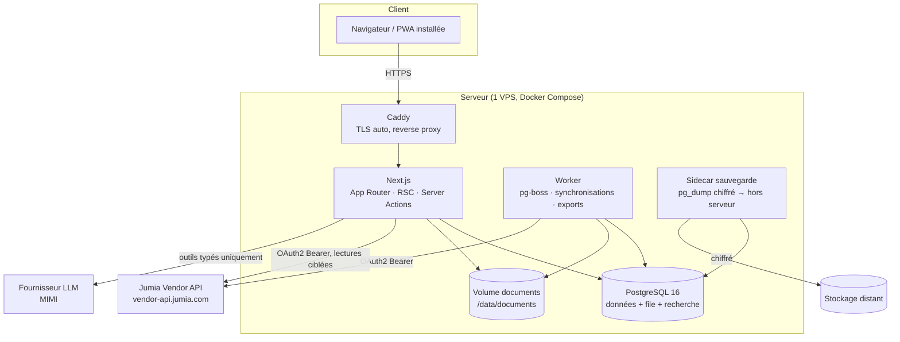

# Architecture — TOUT EN UN BUSINESS MANAGER

> Phase 0 — Cadrage et conception. Statut : **proposition à valider**. Aucun code applicatif n'a été écrit.
> Dernière mise à jour : 2026-11-10.

---

## 1. Contraintes de départ

| Contrainte | Conséquence architecturale |
|---|---|
| 10 à 100+ boutiques Jumia, multi-pays, multi-devises | Multi-tenancy par `shop_id` sur chaque table métier, pas de base par boutique (coût d'exploitation trop élevé, consolidation inter-boutiques difficile) |
| Intégrité des données avant tout | Idempotence par contrainte d'unicité en base, pas par code applicatif ; montants en entiers ; journal d'audit en ajout seul |
| API Jumia limitée (200 req/min, 4 req/s, **par Mastershop**) | File de tâches persistante, planificateur par boutique, backoff, verrou par couple (boutique, ressource) |
| Jetons Jumia **rotatifs** (chaque `/token` invalide l'ancien `refresh_token`) | Renouvellement sous verrou **global par application Jumia**, remplacement atomique, sinon perte définitive du jeton |
| Documents officiels à archiver avec empreinte | Stockage objet + table de métadonnées + hash SHA-256 à l'ingestion |
| Équipe réduite, budget maîtrisé | Monolithe modulaire, un seul déploiement, PostgreSQL pour tout (données, file, recherche, verrous) |
| Garanties financières vérifiables | Module `finance` unique + formules documentées + tests sur cas chiffrés |

---

## 2. Vue d'ensemble



**Un seul processus Next.js** (`web`) + **un seul processus worker** (`worker`), même image Docker, commande différente. Aucune communication réseau entre eux : ils partagent PostgreSQL (données + file pg-boss).

---

## 3. Décisions d'architecture (ADR)

### ADR-001 — Monolithe modulaire Next.js, plutôt que microservices
**Décision.** Une application Next.js unique, découpée en modules (`src/modules/<module>`) avec une API de service interne ; aucune requête inter-modules par HTTP.
**Justification.** Le volume (quelques dizaines de boutiques, commandes de l'ordre de 10³–10⁵/an) ne justifie pas de microservices. Un monolithe modulaire donne la traçabilité transactionnelle (un import de commande = une transaction), un déploiement unique, et une extraction ultérieure possible si un module devait être isolé.
**Règle d'application (linter de structure).** Un module ne peut importer que `src/modules/<autre>.service.ts` (API publique) et jamais `src/modules/<autre>/db/schema.ts` ni ses repositories. Contrôlé par une règle ESLint `no-restricted-imports` sur les chemins internes + revue.

### ADR-002 — PostgreSQL 16 + Drizzle ORM
**Décision.** PostgreSQL pour les données, la file (pg-boss), la recherche (`pg_trgm` + `tsvector`), les verrous (`FOR UPDATE`, `pg_try_advisory_xact_lock`). Drizzle pour le schéma typé et les migrations SQL versionnées.
**Justification.** Moins de composants = moins de pannes. Les contraintes d'unicité en base sont notre garantie anti-doublon. Drizzle produit du SQL lisible et des migrations réversibles écrites à la main (pas de magie de synchronisation de schéma).
**Alternative écartée.** Prisma (moteur binaire, migrations moins contrôlables), TypeORM (typage faible), SQL brut seul (perte de typage).
**Conséquence.** Les migrations sont **écrites et relues** dans `drizzle/` : forward + rollback, méthode expand/contract (voir §7).

### ADR-003 — File de tâches pg-boss
**Décision.** pg-boss (file sur PostgreSQL) avec : retries + backoff exponentiel, dead-letter queue, jobs cron, `singletonKey` pour empêcher deux exécutions concurrentes d'un même job.
**Justification.** Aucune infrastructure supplémentaire (pas de Redis). Le `singletonKey` + un verrou applicatif en base couvrent le besoin « jamais deux synchronisations simultanées pour (boutique, ressource) ».
**Limite connue.** Débit d'environ quelques centaines de jobs/minute — très au-delà de nos besoins (le facteur limitant est Jumia : 4 req/s).
**Alternative écartée.** Redis + BullMQ (composant supplémentaire), Vercel Cron (pas d'exécution longue, pas de concurrence contrôlée).

### ADR-004 — Authentification maison (sessions + 2FA), plutôt qu'un fournisseur externe
**Décision.** Tables `users`, `sessions`, `roles`, `permissions`, `role_permissions`, `user_shop_access`. Mots de passe : Argon2id. Sessions : cookie `HttpOnly`, `Secure`, `SameSite=Lax`, jeton opaque aléatoire 256 bits **haché en base**, expiration glissante, révocation. 2FA TOTP obligatoire pour Propriétaire et Gestionnaire (codes de secours hachés). CSRF : double-submit token + vérification d'origine sur les mutations.
**Justification.** Le modèle de permission demandé est **par module × action × boutique**, avec un journal d'audit qui doit relier chaque action à un utilisateur et à une boutique. Les fournisseurs clés en main (Auth.js + adaptateurs) imposent leurs tables et compliquent ce modèle ; un fournisseur SaaS (Clerk, Auth0) ajoute une dépendance externe pour l'élément le plus critique et envoie des données d'identité hors de notre infrastructure.
**Risque assumé.** Sécurité à implémenter soi-même. Mitigation : périmètre volontairement étroit (email + mot de passe + TOTP, pas de SSO, pas de « mot de passe oublié » en P1 — réinitialisation par le Propriétaire), revue de sécurité en fin de P1, tests d'authentification dédiés, bibliothèques éprouvées (`@node-rs/argon2`, `otplib`).

### ADR-005 — Montants en entiers + devise, jamais de flottants
**Décision.** Tous les montants : `BIGINT` en **unités mineures** + `CHAR(3)` code devise. Les taux de change sont des `NUMERIC(18,10)` datés. Conversion et arrondi centralisés dans `src/modules/finance/money.ts` (aucune autre conversion dans le code).
**Justification.** L'API Jumia renvoie des nombres JSON (double). `0.1 + 0.2` en flottant = écart de centimes, inacceptable sur des milliers de lignes cumulées. De plus, XOF/XAF/UGX n'ont pas de sous-unité (exposant 0) : le module `money` porte la table des exposants par devise et refuse toute opération entre devises différentes sans taux explicite.
**Conséquence.** Le brut Jumia est conservé tel quel (`raw_payload JSONB`) pour pouvoir rejouer une conversion. Voir `docs/formules-financieres.md` §2 et §8.

### ADR-006 — Chiffrement des jetons Jumia (enveloppe AES-256-GCM, clé hors base)
**Décision.** `marketplace_apps` stocke `client_id` en clair et les jetons chiffrés : `secret_ciphertext BYTEA`, `secret_iv BYTEA`, `secret_tag BYTEA`, `key_version SMALLINT`. Chiffrement AES-256-GCM avec **données associées** = `(app_id, champ, key_version)` (empêche de déplacer un chiffré d'une ligne à une autre). Clé maître : fichier monté `/run/secrets/app_enc_key` (ou variable d'environnement injectée par le gestionnaire de secrets), **jamais dans la base, jamais dans une image, jamais dans les logs**. Ring de clés : `APP_ENC_KEYS="1:<base64>,2:<base64>"` + `APP_ENC_ACTIVE=2` pour permettre la rotation sans réécriture bloquante (re-chiffrement paresseux à la prochaine écriture + commande de rotation).
**Justification.** Exigence R4 (chiffré au repos, clé hors base). Le ring évite le « big bang » de rotation.
**Conséquence.** Redaction automatique dans le logger : toute valeur dont la clé matche `token|secret|password|authorization|cookie|api_key` est remplacée par `[redacted]`.

### ADR-007 — Isolation multi-boutiques : trois lignes de défense
1. **Modèle** : `shop_id NOT NULL` + FK + index sur **chaque** table métier ; les unicités incluent `shop_id`.
2. **Repository** : chaque repository expose des fonctions qui **exigent** un `ShopScope` (`{ userId, allowedShopIds }`) ; la construction de la clause `WHERE shop_id` est centralisée dans `src/core/db/scoped.ts`. Aucun repository n'expose de `findAll()` non scopé.
3. **Base (défense en profondeur)** : `ROW LEVEL SECURITY` sur les tables métier, policy sur `current_setting('app.shop_id')` positionné au début de chaque transaction par l'adaptateur.
**Justification.** Les tests d'isolation (demandés explicitement) sont plus fiables avec la RLS qu'avec une simple revue de code. Le coût est un `SET LOCAL` par transaction.
**Décision de séquencement.** RLS activée **en P1/P2 pour les tables existantes**, avec un test automatisé qui échoue si une table métier n'a pas de policy. Si la RLS s'avère gênante pour les agrégats « Toutes les boutiques », on l'assouplit par une vue dédiée `v_aggregates_*` — décision tracée, pas silencieuse.

### ADR-008 — `MarketplaceConnector` : interface, Jumia en premier
**Décision.** Interface interne :
```ts
interface MarketplaceConnector {
  readonly platform: 'jumia';
  authenticate(appId: string): Promise<void>;
  listShops(appId: string): Promise<ExternalShop[]>;
  fetchProducts(ctx, cursor): Promise<Page<ExternalProduct>>;
  fetchOrders(ctx, window, cursor): Promise<Page<ExternalOrder>>;
  fetchOrderItems(ctx, externalOrderId): Promise<ExternalOrderItem[]>;
  fetchStock(ctx, cursor): Promise<Page<ExternalStock>>;
  fetchPayoutStatements(ctx, window): Promise<Page<ExternalStatement>>;
  // écritures : toujours derrière une proposition validée par l'utilisateur
  proposeStockUpdate / proposePriceUpdate / proposeStatusUpdate ...
}
```
**Justification.** Le prompt exige l'ouverture à d'autres plateformes. Une interface **consommatrice** (ce dont notre domaine a besoin) et non un miroir de l'API Jumia évite de laisser fuiter les concepts Jumia dans le domaine.
**Conséquence.** Le connecteur Jumia est le seul endroit où les noms de champs Jumia existent ; le reste du code manipule des types `External*` normalisés. Détails : `docs/jumia-integration.md`.

### ADR-009 — Le stock Jumia fait foi ; nos mouvements sont une comptabilité séparée
**Décision.** Deux notions distinctes, jamais additionnées :
- `inventory_levels.external_qty` : la valeur renvoyée par Jumia (`globalStock`), **remplacée** à chaque synchronisation, horodatée (`external_updated_at`), avec l'état `réelle` si la sync a réussi, `indisponible` (NULL, jamais 0) sinon.
- `stock_movements` : nos mouvements locaux (réceptions fournisseurs, inventaires, retours, transferts), chacun avec un `qty_delta` et un motif.
- `inventory_levels.local_expected_qty` = dérivation de nos mouvements, affichée **à côté** de la valeur Jumia, avec l'écart calculé. Un écart n'est jamais corrigé automatiquement.
**Justification.** Exigence explicite : « la valeur source remplace la valeur locale, sans jamais s'y ajouter » et « aucun cumul artificiel ».
**Conséquence.** La colonne `on_hand` unique et ambiguë est interdite par convention de nommage ; le type TypeScript distingue `ExternalQty | null` et `LocalQty`.

### ADR-010 — PWA maintenant, Electron seulement sur besoin démontré
**Décision.** Manifest + service worker (cache des coquilles, pas des données sensibles), installation sur poste. Electron écarté.
**Justification.** Le besoin réel est « un accès rapide depuis le bureau et le téléphone », couvert par la PWA. Electron ajoute deux chaînes de build et de mise à jour.

### ADR-011 — Déploiement : Docker Compose + Caddy sur un VPS, GitHub Actions
**Décision.** `docker-compose.yml` (prod) : `caddy`, `web`, `worker`, `postgres`, `backup`. Caddy assure HTTPS et le renouvellement TLS automatiques ; un seul domaine officiel (`app.<domaine>`), un domaine de staging (`staging.<domaine>` sur un second compose, base séparée). Images taguées SemVer, `healthcheck` sur `/api/health`, déploiement = `docker compose pull && up -d` avec sauvegarde préalable obligatoire.
**Justification.** Le prompt impose Caddy et une URL permanente. Le VPS (Hetzner CX22 / OVH VPS-2, 2 vCPU / 4 Go) suffit pour l'ordre de grandeur visé.
**Alternative écartée.** Vercel + Neon : excellent pour le front, mais incompatible avec un worker longue durée, avec la file pg-boss et avec l'exigence « serveur stable, un seul déploiement ».
**Points à valider par vous.** Hébergeur, localisation des données (voir `docs/questions-ouvertes.md`).

### ADR-012 — Stockage des documents : volume local + empreinte, sauvegarde distante
**Décision.** Les documents (étiquettes PDF, relevés JSON, exports, pièces jointes fournisseurs, documents internes) sont stockés sur un volume `/data/documents/<shop_id>/<yyyy>/<mm>/<uuid>.<ext>`, métadonnées en base (`documents` : type, source, taille, `sha256`, `original_filename`, `content_type`, `retrieved_at`). Suppression logique seulement (jamais de suppression physique d'un document officiel). Sauvegarde : copie chiffrée hors serveur.
**Justification.** Simplicité et coût. Le volume de documents reste modeste (PDF de quelques dizaines de Ko).
**Évolution prévue.** Abstraction `DocumentStore` (interface `put/get/stat`) pour basculer vers S3 compatible sans toucher au domaine.

### ADR-013 — Observabilité minimale mais réelle
**Décision.** Logs structurés JSON (pino) avec redaction, `request_id` et `shop_id` en contexte ; table `system_events` pour les incidents affichés dans l'écran Système ; deux endpoints : `/api/health` (liveness) et `/api/health/deep` (base, migrations, file, dernier job réussi par boutique) ; métriques dérivées de la base plutôt qu'un Prometheus en P1.
**Justification.** L'écran Système demandé au Propriétaire se nourrit directement de la base : pas de stack d'observabilité à exploiter. Sentry peut être ajouté plus tard si vous le souhaitez (question ouverte).
**Conséquence.** Un `ERROR` non rattrapé dans le worker crée une ligne `system_events` **et** une notification `incident` (email inclus pour les incidents critiques).

### ADR-014 — Recherche : PostgreSQL d'abord
**Décision.** `pg_trgm` (fuzzy sur nom/SKU) + `tsvector` généré (`to_tsvector('french', ...)`) + index GIN. Recherche globale = une requête par catégorie, exécutées en parallèle, limitées à 5 résultats chacune, filtrées par `ShopScope`.
**Justification.** Évite Meilisearch/Elastic. À 10⁵ lignes, PostgreSQL répond en quelques millisecondes.
**Seuil de bascule documenté.** Si le p95 de la recherche dépasse 300 ms sur données réelles, on ajoute un index dédié (Meilisearch) — décision tracée, pas anticipée.

### ADR-015 — MIMI : outils typés, fournisseur interchangeable
**Décision.** MIMI n'a **aucun** accès SQL. Elle appelle des outils déclarés dans `src/modules/mimi/tools/` (nom, schéma Zod, permission requise, handler passant par les services des autres modules avec le `ShopScope` de l'utilisateur). Un adaptateur `LlmProvider` isole le fournisseur (OpenAI / Anthropic / autre) derrière une interface commune. Chaque appel est journalisé (`mimi_tool_calls` : outil, arguments, durée, statut, empreinte du résultat).
**Justification.** Anti-hallucination structurelle : un chiffre affiché provient d'un résultat d'outil enregistré, donc auditable. Le changement de fournisseur ne touche qu'un fichier.
**Conséquence.** Aucune fonctionnalité MIMI n'est livrée avant la P5, et elle sera **absente** de l'interface jusque-là (R1 : pas de bouton décoratif).

---

## 4. Découpage en modules

```
src/
  app/                        # routes Next.js (App Router) — coquilles minces
  core/
    config/                   # app.config.ts (NOM OFFICIEL, devises, fuseau…)
    db/                       # client Drizzle, scoped.ts, migrations, seeds
    auth/                     # sessions, 2FA, permissions (service)
    crypto/                   # enveloppe AES-GCM, ring de clés
    money/                    # unités mineures, devises, arrondis, allocation
    logger/  audit/  errors/  validation/  http/
  modules/
    shops/                    # boutiques, comptes Jumia (marketplace_apps), accès
    jumia-integration/        # connecteur HTTP + mapping (seul endroit "Jumia")
    sync/                     # orchestration, verrous, curseurs, historique
    products/  orders/  inventory/  warehouses/  invoices/
    finance/                  # commissions, marges, bénéfices, rapprochement
    purchasing/  returns/  reports/  notifications/  exports/
    mimi/  jobs/  monitoring/
  ui/                         # design system (composants), navigation.config.ts
  tests/                      # unit, integration (testcontainers), e2e (Playwright)
```

| Module | Responsabilité | Dépend de (services) |
|---|---|---|
| `shops` | Boutiques, comptes Jumia, accès utilisateur↔boutique, statuts | `audit` |
| `jumia-integration` | Auth OAuth2, appels HTTP, mapping External*, gestion 429/backoff | `crypto`, `shops` (lecture) |
| `sync` | Lancer/reprendre une sync, verrous, curseurs, compteurs, statut honnête | `jumia-integration`, `products`, `orders`, `inventory`, `finance` |
| `products` | Catalogue, SKU, doublons, images, statuts | `inventory` (lecture) |
| `orders` | Commandes, lignes, statuts, retards | `products` (lecture) |
| `inventory` | Niveaux, mouvements, inventaires, écarts vs Jumia | `warehouses` |
| `finance` | Formules, relevés, dépenses, marges, rapprochement | `orders`, `inventory`, `purchasing` |
| `purchasing` | Fournisseurs, commandes fournisseurs, coûts d'achat | `inventory`, `products` |
| `returns` | Retours, remboursements, contrôle qualité, réintégration | `orders`, `inventory`, `finance` |
| `reports`, `exports` | Agrégats, exports Excel/CSV/PDF | services de lecture des autres modules |
| `notifications` | Notifications, regroupement, emails critiques | `audit` |
| `mimi` | Conversations, outils typés, propositions | services de lecture + `shops` |
| `jobs` | Enregistrement des queues, cron, DLQ, reprise | `sync`, `reports` |
| `monitoring` | Healthchecks, écran Système, `system_events` | tous en lecture |

**Frontières interdites.** `finance` n'écrit jamais dans `orders` ; `sync` n'écrit jamais dans `finance` directement (il publie des faits, `finance` les traite). Un module peut lire via l'API publique d'un autre module, jamais via ses tables.

---

## 5. Flux de données

### 5.1 Synchronisation d'une ressource (boutique)

```mermaid
sequenceDiagram
  participant Cron as Worker (cron)
  participant Sync as sync.service
  participant Lock as sync_locks (PG)
  participant Conn as jumia-integration
  participant DB as Tables métier
  Cron->>Sync: run(shopId, resource, mode)
  Sync->>Lock: pg_try_advisory_xact_lock(shop, resource)
  alt verrou déjà pris
    Sync-->>Cron: "ignoré — sync en cours" (compté)
  else verrou obtenu
    Sync->>Sync: sync_run = INSERT(status='running', cursor=persisted)
    loop pages
      Sync->>Conn: fetchPage(cursor)
      alt 429
        Sync->>Sync: backoff (Retry-After | exponentiel + jitter)
      end
      Sync->>DB: upsert idempotent (shop_id, external_id)
      Sync->>Sync: sync_run.cursor = nextToken ; COMMIT
    end
    Sync->>Sync: status = 'synced' si toutes les pages OK, sinon 'partial'
  end
```

**Points non négociables.**
- Le curseur est **commité avec les données de la page** : après une coupure brutale, on reprend au `nextToken` persisté, sans rejouer ni sauter de page.
- `upsert` sur `(shop_id, external_id)` → relancer une synchronisation ne crée jamais de doublon (P2 : test dédié en double exécution).
- Statut `synced` **uniquement** si toutes les pages ont réussi et si `isLastPage=true` a été observé.

### 5.2 Lecture d'un écran (ex. tableau de bord)

`Server Component` → `service de lecture` (avec `ShopScope`) → requête SQL agrégée (ou table d'agrégats précalculés `daily_shop_metrics`) → rendu. **Aucune donnée métier chargée côté client** : le sélecteur de boutique déclenche une navigation serveur (`?shop=…`), donc le filtrage est serveur par construction.

### 5.3 Une écriture déclenchée par l'utilisateur

`Formulaire (Server Action)` → `Zod` → `authz(permission, shopScope)` → `service` (transaction) → `audit_log` + `notification` éventuelle → `revalidate`. Pour une écriture **chez Jumia** : création d'une `proposal` (avant/après) → validation explicite → envoi → suivi du `feed` Jumia → statut final consigné. Une proposition jamais validée n'envoie rien.

---

## 6. Environnements et configuration

| Environnement | Rôle | Base | Jetons Jumia | Données |
|---|---|---|---|---|
| `development` | poste local | Docker local | jamais | `seed` explicite (jeu de démonstration, préfixé `demo-`) |
| `staging` | répétition, URL `staging.<domaine>` | base séparée | application Jumia **staging** uniquement | réel de staging ou seed ; aucune donnée de production copiée |
| `production` | URL officielle | base dédiée | applications Jumia live | réelles |

**Configuration** dans `src/core/config/app.config.ts` : nom officiel `TOUT EN UN BUSINESS MANAGER` (une seule variable, réutilisée par le titre, le logo, les emails, les exports), nom court, devise de référence d'affichage, fuseau (`Africa/Abidjan`), seuils (stock faible, marge minimale), fréquences de synchronisation. Aucun de ces libellés n'est écrit en dur ailleurs (test de non-régression sur la chaîne).

**Secrets** (hors dépôt) : `DATABASE_URL`, `APP_ENC_KEYS`/`APP_ENC_ACTIVE`, `SESSION_SECRET`, `SMTP_*`, `LLM_API_KEY` (P5), `BACKUP_*`. Injectés par fichier `.env` non versionné + secrets GitHub pour la CI (valeurs factices uniquement).

---

## 7. Migration, rollback, sauvegarde

**Migrations.** Fichiers SQL numérotés, revus, chacun avec son `down`. Méthode **expand/contract** en trois temps pour toute évolution risquée : (1) *expand* — ajout de colonne/table nullable + double écriture ; (2) *migration des données* par job idempotent ; (3) *contract* — suppression de l'ancien, dans une version ultérieure. Une migration ne mélange jamais DDL et remplissage massif de données.

**Sauvegarde.** `pg_dump` chiffré (age/GPG) quotidien + WAL archivés pour un RPO plus fin si nécessaire, copie hors serveur, rétention 7 jours / 4 semaines / 12 mois. Documents : synchronisation quotidienne incrémentale du volume.
Objectifs proposés (à confirmer) : **RPO ≤ 24 h** (dump quotidien) ou **≤ 15 min** si WAL archivé ; **RTO ≤ 2 h** (restauration documentée et testée).
**Restauration testée** : job hebdomadaire qui restaure le dernier dump dans une base jetable, vérifie les `COUNT(*)` d'un jeu de tables de contrôle et les `sha256` d'un échantillon de documents, puis publie le résultat dans l'écran Système. Un test de restauration en échec est un incident critique.

---

## 8. Sécurité (base de référence)

| Mesure | Implémentation |
|---|---|
| Validation des entrées | Zod sur **toutes** les Server Actions, route handlers, jobs, réponses Jumia (parsing strict + rejet) |
| Autorisation | `authz()` serveur : authentification, permission `module:action`, appartenance de la boutique au scope. Testé par rôle et par route (table de tests générée depuis `navigation.config.ts` + liste des actions) |
| CSRF | Jeton double-submit + vérification `Origin`/`Sec-Fetch-Site` sur les mutations |
| Limitation de débit | Par IP et par utilisateur sur login, 2FA, recherche, exports, actions IA (table `rate_limits` en base, pas de Redis) |
| Sessions | Cookie opaque 256 bits haché, `HttpOnly`/`Secure`/`SameSite=Lax`, expiration glissante 12 h, révocation par appareil, déconnexion globale |
| Mots de passe | Argon2id (paramètres 2026, `m=19456,t=2,p=1`), politique de longueur, vérification contre liste de mots de passe compromis (hash local) |
| 2FA | TOTP obligatoire Propriétaire/Gestionnaire, codes de secours à usage unique |
| En-têtes | CSP stricte (nonce), HSTS, `X-Content-Type-Options`, `Referrer-Policy`, `Permissions-Policy`, `frame-ancestors 'none'` |
| Secrets | Chiffrés au repos, jamais dans les logs, jamais envoyés au navigateur (test automatisé : aucun `access_token`/`refresh_token` dans le HTML/RSC/payload d'API interne) |
| Audit | `audit_log` en ajout seul (trigger `BEFORE UPDATE/DELETE` → exception), rétention 5 ans |
| Injection Excel/CSV | Neutralisation des cellules commençant par `= + - @ TAB CR` dans tous les exports |
| Dépendances | `npm audit` en CI, Dependabot, `pnpm` avec lockfile et `--frozen-lockfile` |

---

## 9. Performance — cibles et moyens

| Cible | Moyen |
|---|---|
| Affichage initial < 2 s avec 100 boutiques | cartes réduites par défaut, pagination 20/boutique, agrégats précalculés (`daily_shop_metrics`), RSC, aucune requête N+1 (détection en test) |
| Interactions perçues < 100 ms | filtres/sélecteur en navigation serveur avec `Suspense` + états squelettes ; pas de bibliothèque de data-fetching client lourde |
| Recherche p95 < 300 ms | index GIN trigram + tsvector, `LIMIT 5` par catégorie |
| Rapport mensuel 100 boutiques < 5 s | agrégats incrémentaux par jour et par boutique, recalcul nocturne, jamais d'agrégation à la volée sur les lignes de commande |

**Test de charge minimal** en P8 : jeu de données synthétique (100 boutiques × 50 k lignes) + mesure des pages clés, seuils ci-dessus comme critères d'acceptation.

---

## 10. Ce que cette architecture refuse explicitement

- **Pas de cache applicatif opaque** sur les montants : les agrégats sont matérialisés, versionnés (`computed_at`) et affichés avec leur fraîcheur. Un total sans date de calcul est un total faux.
- **Pas de « valeur par défaut » pour une donnée manquante** : `NULL` + affichage « — ».
- **Pas de correction automatique** d'un écart de stock ou d'un écart de facture : proposition + validation.
- **Pas de synchronisation « best effort » silencieuse** : une sync partielle est affichée comme partielle, avec le détail.
- **Pas d'Electron, pas de microservices, pas de Redis, pas de Meilisearch** en P1–P5 : ajout seulement sur mesure réelle.

---

## 11. Points ouverts liés à l'architecture

1. Hébergeur et localisation (RGPD/CI) → impacte sauvegardes hors site et TLS.
2. RLS activée partout dès P1, ou progressive ? (proposition : dès P1, gate en CI).
3. WAL archiving (RPO 15 min) dès la P1 ou plus tard ? (coût d'exploitation).
4. Fournisseur LLM pour MIMI (et acceptation de sortie de données agrégées vers un tiers).
5. Confirmation des durées de conservation (audit 5 ans, documents officiels illimités, logs 90 jours).
