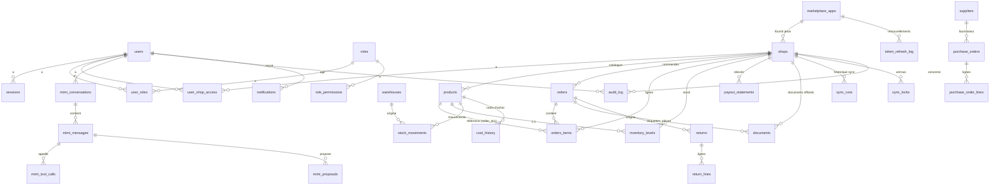

# Schéma de base de données — TOUT EN UN BUSINESS MANAGER

> Phase 0. Proposition à valider. Le schéma complet et exécutable sera produit en P1 (migration `0001_init`), ici il est **conçu et justifié**, table par table.
> PostgreSQL 16 · Drizzle ORM · migrations SQL versionnées.

---

## 1. Conventions

| Sujet | Convention |
|---|---|
| Nommage | tables au pluriel, `snake_case` ; clés étrangères `<table_singulier>_id` ; horodatages `created_at`, `updated_at` |
| Identifiants internes | `BIGINT GENERATED ALWAYS AS IDENTITY` (jamais exposés dans les URL publiques) + `public_id UUID` pour les entités manipulées par l'interface |
| Identifiants externes | `external_id TEXT` (SID Jumia) toujours accompagné de `shop_id`, unicité `(shop_id, external_id)` |
| Montants | `*_minor BIGINT` (unités mineures) + `currency CHAR(3)`. Jamais de `numeric` ni de `double precision` pour un montant **stocké** |
| Taux | `NUMERIC(18,10)` (taux de change, taux de commission) — jamais utilisés comme montants |
| Horodatages | `TIMESTAMPTZ` en UTC, défaut `now()`. L'affichage applique le fuseau configuré |
| Dates métier Jumia | Jumia renvoie des chaînes `yyyy-MM-dd HH:mm:ss` **sans fuseau** : on stocke la chaîne brute dans `raw_payload` **et** une interprétation `TIMESTAMPTZ` selon le fuseau du pays de la boutique, avec la colonne `timestamp_assumption` = `assumed_country_tz` |
| Suppression | `deleted_at TIMESTAMPTZ NULL` (logique) sur les entités métier ; **aucune suppression physique** sur `documents`, `audit_log`, `payout_statements` |
| Énumérations | types `ENUM` PostgreSQL pour les valeurs stables (statuts), `TEXT + CHECK` pour les listes susceptibles d'évoluer |
| Commentaires | `COMMENT ON COLUMN` pour chaque colonne dont le sens n'est pas évident (généré depuis le schéma Drizzle) |
| Isolation | `shop_id NOT NULL REFERENCES shops(id)` sur **toute** table métier + index + inclusion dans les unicités |

**Deux tables sans `shop_id`** (justifié) : `users`, `marketplace_apps` (un compte Jumia couvre plusieurs boutiques), plus les tables purement techniques (`rate_limits`, `system_events` — qui porte un `shop_id` nullable).

---

## 2. Modèle multi-boutiques : la décision structurante

Une **application Jumia** (Vendor Center) est créée par compte vendeur et un même jeton donne accès à **plusieurs boutiques, elles-mêmes déclinées par pays** (`businessClients` : `jumia-ci`, `jumia-ng`…).

```
marketplace_apps (1) ──< shops (1) ──< toutes les tables métier
        │                    │
   client_id,            jumia_shop_sid (UUID Jumia)
   refresh_token chiffré business_client_code (ex. jumia-ci)
                         country_code (CI), currency (XOF)
```

**Décision.** Une ligne `shops` = **un couple (boutique Jumia, business client/pays)**.
**Justification.** Prix, stock, commandes et relevés Jumia sont **par business client**. Deux pays d'une même boutique ont deux devises et deux stocks ; les fusionner rendrait tout calcul faux. C'est aussi l'unité du sélecteur de boutique et du filtre `shopId` de l'API.
**Conséquence.** Unicité : `UNIQUE (jumia_shop_sid, business_client_code)` → « une même boutique réelle ne peut pas être ajoutée deux fois ». Le nom affiché (`display_name`) est libre, le nom Jumia (`jumia_shop_name`) est en lecture seule.

---

## 3. Diagramme (noyau)



*(Diagramme complet généré en P1 depuis le schéma Drizzle — `docs/database/er-full.svg`.)*

---

## 4. Tables par module

### 4.1 `shops` — boutiques et comptes Jumia

**`marketplace_apps`** (pas de `shop_id`)

| Colonne | Type | Contraintes |
|---|---|---|
| `id` | BIGINT PK | |
| `platform` | TEXT | `CHECK IN ('jumia')` |
| `label` | TEXT | nom interne du compte (« Compte Jumia principal ») |
| `client_id` | TEXT | non secret |
| `refresh_token_ciphertext` | BYTEA | AES-256-GCM |
| `refresh_token_iv`, `refresh_token_tag` | BYTEA | |
| `access_token_ciphertext/iv/tag` | BYTEA NULL | cache du jeton d'accès |
| `access_token_expires_at` | TIMESTAMPTZ NULL | issu de `expires_in` (jamais codé en dur) |
| `refresh_token_expires_at` | TIMESTAMPTZ NULL | issu de `refresh_expires_in` ; alerte à J-7 |
| `key_version` | SMALLINT | ring de clés |
| `status` | ENUM `app_status` | `active`, `reauth_required`, `error`, `disabled` |
| `last_refresh_at`, `last_error_at`, `last_error_code` | | diagnostic sans secret |
| `created_at`, `updated_at` | TIMESTAMPTZ | |

Index : `(status)`. Contrainte : `UNIQUE (platform, client_id)`.
**Point clé.** Le renouvellement se fait **sous verrou consultatif PostgreSQL** `pg_advisory_xact_lock(hashtext('app:'||id))`, avec lecture du jeton juste avant l'appel et écriture du **nouveau** refresh_token dans la même transaction. Voir `docs/jumia-integration.md` §4.

**`shops`**

| Colonne | Type | Contraintes |
|---|---|---|
| `id` | BIGINT PK | |
| `public_id` | UUID | `UNIQUE`, utilisé dans les URL |
| `app_id` | BIGINT FK `marketplace_apps` | `NOT NULL` |
| `jumia_shop_sid` | UUID | SID Jumia |
| `business_client_code` | TEXT | ex. `jumia-ci` |
| `business_client_name` | TEXT | `Jumia` / `Zando` |
| `country_code` | CHAR(2) | `CI, DZ, EG, GH, KE, MA, NG, SN, TN, UG, ZA` |
| `currency` | CHAR(3) | déduite du pays, contrôlée à l'ajout |
| `jumia_shop_name` | TEXT | lecture seule (venant de Jumia) |
| `display_name` | TEXT | libre, non vide |
| `short_code` | TEXT | `businessClients[].shortCode` (utile pour les relevés) |
| `status` | ENUM `shop_status` | `connected`, `syncing`, `synced`, `partial`, `error`, `reauth_required`, `disabled` |
| `sync_enabled` | BOOLEAN | défaut `true` |
| `sync_interval_minutes` | INT | borné par les limites Jumia (plancher 5 min proposé) |
| `timezone` | TEXT | pour interpréter les dates Jumia non ISO |
| `created_at`, `updated_at`, `deleted_at` | | |

Contraintes : `UNIQUE (jumia_shop_sid, business_client_code)`, `UNIQUE (public_id)`, `CHECK (sync_interval_minutes BETWEEN 5 AND 1440)`.
Index : `(public_id)`, `(status)`, `(app_id)`, `(country_code)`.

**`user_shop_access`** : `(user_id, shop_id)` PK, `can_view BOOLEAN`, `created_at`. Détermine le `ShopScope` serveur.

### 4.2 Identité, rôles, audit

| Table | Colonnes clés | Contraintes / index |
|---|---|---|
| `users` | `id`, `public_id`, `email CITEXT UNIQUE`, `password_hash`, `display_name`, `status` (`active`,`suspended`), `totp_secret_ciphertext` (NULL), `totp_enabled_at`, `totp_recovery_codes_hash TEXT[]`, `failed_login_count`, `locked_until`, `last_login_at`, `timezone`, `theme_preference` (`system`,`light`,`dark`) | index `(email)`, `(status)` |
| `sessions` | `id`, `user_id`, `token_hash BYTEA UNIQUE`, `ip_hash`, `user_agent`, `created_at`, `last_seen_at`, `expires_at`, `revoked_at` | index `(user_id, expires_at)` |
| `roles` | `id`, `code` UNIQUE (`owner`,`manager`,`stock_manager`,`accountant`,`assistant`), `label`, `is_system` | 5 rôles système non supprimables |
| `permissions` | `id`, `code` UNIQUE (`orders:read`, `inventory:write`, `finance:read`, `settings:manage`…), `module`, `action`, `label` | alimentée par une liste de référence versionnée |
| `role_permissions` | `(role_id, permission_id)` PK | |
| `user_roles` | `(user_id, role_id, shop_id NULL)` PK | `shop_id NULL` = rôle global ; sinon rôle sur une boutique |
| `audit_log` | `id`, `occurred_at`, `actor_user_id NULL` (NULL = système), `actor_ip_hash`, `shop_id NULL`, `module`, `action`, `entity_type`, `entity_public_id`, `before JSONB`, `after JSONB`, `result` (`success`,`failure`), `error_code`, `request_id` | **ajout seul** : trigger `BEFORE UPDATE OR DELETE → RAISE EXCEPTION`. Index `(shop_id, occurred_at DESC)`, `(actor_user_id, occurred_at DESC)`, `(entity_type, entity_public_id)` |
| `rate_limits` | `(bucket, key_hash, window_start)` PK, `count` | purge par job |
| `system_events` | `id`, `occurred_at`, `severity` (`info`,`warning`,`critical`), `category`, `shop_id NULL`, `code`, `message`, `context JSONB`, `acknowledged_at`, `acknowledged_by` | index `(severity, occurred_at DESC)` |

### 4.3 Catalogue

**`products`**

`id`, `public_id`, `shop_id`, `external_id` (product SID Jumia, NULL tant que le produit n'existe pas chez Jumia), `seller_sku`, `parent_sku`, `name`, `description`, `brand_code`, `brand_name`, `category_code`, `category_name`, `attribute_set_id`, `attributes JSONB` (brut Jumia), `status ENUM` (`not_ready_to_qc`,`pending`,`approved`,`rejected`,`active`,`inactive`,`deleted`), `qc_status`, `visible BOOLEAN`, `is_local_draft BOOLEAN` (créé par MIMI, pas encore publié), `main_image_url`, `global_price_minor BIGINT NULL`, `global_price_currency CHAR(3) NULL`, `sale_price_minor`, `sale_price_start_at`, `sale_price_end_at`, `external_created_at`, `external_updated_at`, `last_synced_at`, `raw_payload JSONB`, `deleted_at`, `created_at`, `updated_at`.

Contraintes : `UNIQUE (shop_id, seller_sku)` ; `UNIQUE (shop_id, external_id) WHERE external_id IS NOT NULL` ; index trigram sur `name`, index `(shop_id, status)`, index `(shop_id, category_code)`.
*Note :* `parent_sku` + `variation` pour gérer les produits à variations Jumia (champ `variations` de l'API).

**`product_images`** : `id`, `shop_id`, `product_id`, `url`, `position`, `is_primary`, `sha256 NULL` (si image rapatriée). `UNIQUE (product_id, position)`.
**`sku_sequences`** : `prefix TEXT PK`, `last_value INT NOT NULL`, `updated_at`. Allouée **dans la transaction** qui crée le produit : `UPDATE sku_sequences SET last_value = last_value + 1 WHERE prefix = $1 RETURNING last_value`. Jamais de réutilisation (pas de remise en arrière même en cas de rollback — le trou est acceptable, le doublon ne l'est pas ; alternative retenue : `SELECT ... FOR UPDATE` + incrément dans la même transaction, le rollback annule alors l'incrément, ce qui est sûr car aucune ligne n'a été créée).

**Référentiels Jumia mis en cache** : `categories` (`platform`, `code`, `name`, `parent_code`, `attribute_set_id`), `brands` (`platform`, `code`, `name`), `attribute_sets` (`platform`, `id`, `category_code`, `attributes JSONB`). Rafraîchis par job hebdomadaire. Pas de `shop_id` : ce sont des référentiels plateforme.

### 4.4 Commandes

**`orders`** : `id`, `public_id`, `shop_id`, `external_id` (order SID), `order_number`, `status` (`pending`,`ready_to_ship`,`shipped`,`delivered`,`canceled`,`returned`,`failed`,`multiple`), `country_code`, `currency CHAR(3)` (devise locale), `total_minor BIGINT` (**USD**, champ `totalAmount`), `total_currency CHAR(3)`, `total_local_minor`, `is_prepayment`, `has_multiple_status`, `has_items_fulfilled_by_jumia`, `pending_since_text`, `delivery_option`, `shipping_address JSONB` (données personnelles : accès restreint `orders:read:pii`), `external_created_at`, `external_updated_at`, `last_synced_at`, `raw_payload JSONB`, `created_at`, `updated_at`.
Contraintes : `UNIQUE (shop_id, external_id)` ; `UNIQUE (shop_id, order_number)` ; index `(shop_id, status)`, `(shop_id, external_created_at DESC)`, `(external_updated_at)`.

**`orders_items`** : `id`, `shop_id`, `order_id`, `external_id` (order item SID), `seller_sku`, `product_id NULL` (résolution par SKU, peut manquer), `product_name`, `status`, `status_detail JSONB` (retour/QC), `item_price_minor`, `paid_price_minor`, `shipping_amount_minor`, `item_price_local_minor`, `paid_price_local_minor`, `shipping_amount_local_minor`, `exchange_rate NUMERIC(18,10)`, `tax_amount_minor`, `voucher_amount_minor`, `currency`, `is_fulfilled_by_jumia`, `shipment_type`, `tracking_number`, `shipped_at`, `raw_payload JSONB`, `last_synced_at`.
Contraintes : `UNIQUE (shop_id, external_id)` ; index `(shop_id, seller_sku)`, `(order_id)`.

**`order_status_history`** : `id`, `shop_id`, `order_item_id`, `from_status`, `to_status`, `source` (`api`,`manual`,`import`), `occurred_at`, `raw JSONB`. Ajout seul. Permet « détection des retards et des anomalies ».

### 4.5 Stocks et entrepôts

**`warehouses`** : `id`, `public_id`, `shop_id NULL` (NULL = entrepôt central partagé), `name`, `code UNIQUE per shop`, `type` (`central`,`transit`,`marketplace`), `address JSONB`, `is_active`.
**`warehouse_locations`** : `id`, `warehouse_id`, `code`, `label`. `UNIQUE (warehouse_id, code)`.

**`inventory_levels`** (une ligne par produit **et** par emplacement logique)

| Colonne | Sens |
|---|---|
| `shop_id`, `product_id`, `warehouse_id` | PK composite `(shop_id, product_id, warehouse_id)` |
| `external_qty INT NULL` | **valeur Jumia** (`globalStock`), remplacée à chaque sync. `NULL` = indisponible, jamais 0 |
| `external_updated_at`, `external_synced_at` | fraîcheur |
| `reserved_qty INT NULL` | réservations calculées depuis les commandes `PENDING` (dérivé) |
| `local_expected_qty INT` | dérivation de nos mouvements (réceptions − sorties), à des fins de comparaison |
| `reorder_point INT NULL`, `reorder_qty INT NULL` | seuils d'alerte |
| `version INT NOT NULL DEFAULT 0` | **verrouillage optimiste** : toute écriture locale exige `version` connue |

**`stock_movements`** (ajout seul) : `id`, `shop_id`, `product_id`, `warehouse_id`, `type` (`receipt`,`sale_out`,`return_in`,`transfer_out`,`transfer_in`,`adjustment`,`inventory_count`,`write_off`), `qty_delta INT` (signé, jamais 0), `reference_type`, `reference_id`, `reason`, `note`, `actor_user_id NULL`, `occurred_at`, `created_at`. Index `(shop_id, product_id, occurred_at DESC)`.
**Interdiction structurelle** : `CHECK (qty_delta <> 0)` et **aucune** colonne d'agrégat de stock mise à jour par cumul automatique depuis Jumia.

**`inventory_sessions`** / **`inventory_counts`** : session d'inventaire (statut `draft`,`counting`,`review`,`validated`,`cancelled`) et lignes comptées (`expected_qty`, `counted_qty`, `difference`, `validated_by`). Une session validée génère des `stock_movements` de type `inventory_count`.

**`stock_discrepancies`** : `id`, `shop_id`, `product_id`, `external_qty`, `local_expected_qty`, `delta`, `detected_at`, `resolved_at`, `resolution` (`accepted_external`,`corrected_local`,`ignored`), `resolved_by`. Aucune correction n'est appliquée sans `resolution` explicite.

### 4.6 Finances

**`payout_statements`** — la **seule source confirmée** des montants Jumia.

| Colonne | Source API |
|---|---|
| `statement_number`, `shop_id`, `created_at_external`, `updated_at_external` | `statementNumber`, `shopSid`, `createdAt`, `updatedAt` |
| `opening_balance_minor`, `item_revenue_minor`, `shipment_fee_minor`, `shipment_fee_credit_minor`, `other_revenue_total_minor`, `fees_total_minor`, `subtotal1_minor`, `refunds_minor`, `fees_on_refunds_total_minor`, `subtotal2_minor`, `closing_balance_minor`, `guarantee_deposit_minor`, `payout_amount_minor`, `subsidy_minor`, `subsidy_refund_minor` | champs homonymes |
| `currency CHAR(3)`, `currency_requested` (`LOCAL`/`USD`), `paid BOOLEAN`, `payment_reference TEXT` | |
| `raw_payload JSONB`, `fetched_at` | traçabilité |

Contraintes : `UNIQUE (shop_id, statement_number)` ; index `(shop_id, created_at_external DESC)`.
On **stocke aussi** le montant en USD et en devise locale si les deux sont récupérés (deux lignes de relevé → une ligne par `(statement_number, currency_requested)` → clé `UNIQUE (shop_id, statement_number, currency_requested)`).

**`expenses`** : `id`, `public_id`, `shop_id NULL` (NULL = dépense globale, répartie), `category_id`, `label`, `amount_minor`, `currency`, `amount_eur_minor NULL` (si devise ≠ devise de référence, avec `fx_rate_id`), `fx_rate_id NULL`, `incurred_on DATE`, `supplier_id NULL`, `purchase_order_id NULL`, `attachment_document_id NULL`, `created_by`, `created_at`, `deleted_at`.
**`expense_categories`** : `id`, `code`, `label`, `is_import_cost`, `is_shipping_cost`.
**`fx_rates`** : `id`, `base CHAR(3)`, `quote CHAR(3)`, `rate NUMERIC(18,10)`, `effective_on DATE`, `source` (`manual`,`ecb`,`api`), `created_by`. `UNIQUE (base, quote, effective_on)`. **Toute conversion affiche son taux et sa date.**
**`cost_history`** : `id`, `shop_id`, `product_id`, `unit_cost_minor`, `currency`, `effective_from DATE`, `supplier_id NULL`, `source` (`purchase`,`manual`,`import_cost`), `created_by`. Index `(shop_id, product_id, effective_from DESC)`. Le coût applicable à une ligne de commande est celui **en vigueur à la date de la commande** (jamais le coût courant — sinon les marges passées changeraient rétroactivement).
**`import_costs`** : `id`, `shop_id NULL`, `label`, `amount_minor`, `currency`, `allocation_method` (`per_unit`,`per_value`,`manual`), `period_start`, `period_end`, `allocation JSONB` (détail par produit/lot), `fx_rate_id`.
**`payment_reconciliations`** : `id`, `shop_id`, `payout_statement_id`, `bank_transaction_ref`, `amount_minor`, `currency`, `status` (`unmatched`,`matched`,`disputed`), `matched_by`, `matched_at`. Rapprochement manuel validé, jamais automatique.

### 4.7 Achats, fournisseurs, retours

| Table | Colonnes clés |
|---|---|
| `suppliers` | `id`, `public_id`, `shop_id NULL`, `name`, `contact JSONB`, `payment_terms`, `lead_time_days`, `currency`, `notes`, `deleted_at` |
| `purchase_orders` | `id`, `public_id`, `shop_id`, `supplier_id`, `reference`, `status` (`draft`,`sent`,`partially_received`,`received`,`cancelled`), `currency`, `ordered_at`, `expected_at`, `received_at`, `total_minor`, `document_id NULL` |
| `purchase_order_lines` | `id`, `purchase_order_id`, `shop_id`, `product_id NULL`, `seller_sku`, `qty_ordered`, `qty_received`, `unit_cost_minor`, `line_total_minor` |
| `purchase_receipts` | `id`, `purchase_order_id`, `shop_id`, `received_at`, `warehouse_id`, `document_id NULL`, `created_by` → génère des `stock_movements` `receipt` |
| `returns` | `id`, `public_id`, `shop_id`, `external_return_ref`, `order_id`, `order_item_id`, `status` (`requested`,`received`,`qc`,`accepted`,`rejected`,`refunded`,`closed`), `reason_code`, `reason_text`, `damage_responsibility`, `damage_level_reason`, `refund_amount_minor`, `currency`, `qc_result JSONB`, `reintegrated_stock BOOLEAN`, `created_at`, `closed_at` |
| `return_lines` | `id`, `return_id`, `shop_id`, `product_id NULL`, `seller_sku`, `qty`, `condition` (`new`,`damaged`,`unsellable`), `action` (`restock`,`write_off`,`repair`) |

`returns` alimente `finance` (remboursement, perte) et `inventory` (réintégration **après** contrôle qualité validé).

### 4.8 Synchronisation et surveillance

**`sync_runs`** : `id`, `shop_id`, `resource` (`shops`,`products`,`orders`,`order_items`,`stock`,`payout_statements`,`categories`,`brands`), `mode` (`initial`,`incremental`,`manual`,`reconciliation`), `status` (`queued`,`running`,`synced`,`partial`,`failed`,`aborted`), `started_at`, `finished_at`, `duration_ms`, `window_from`, `window_to`, `pages_total NULL`, `pages_done`, `cursor_before`, `cursor_after`, `items_read`, `items_created`, `items_updated`, `items_skipped`, `items_failed`, `error_code`, `error_message`, `triggered_by` (`cron`,`user:<id>`,`system`), `request_id`.
Index : `(shop_id, resource, started_at DESC)`, `(status) WHERE status IN ('queued','running')`.

**`sync_cursors`** : `(shop_id, resource)` PK, `cursor TEXT`, `window_from`, `window_to`, `updated_at`, `sync_run_id`. Le curseur est écrit **dans la transaction** qui écrit la page de données.
**`sync_locks`** : `(shop_id, resource)` PK, `acquired_at`, `expires_at`, `owner_token`, `heartbeat_at`, `sync_run_id`. Table de visibilité (le verrou réel est consultatif PostgreSQL) ; les verrous orphelins (`heartbeat_at < now() - interval '10 min'`) sont détectés par job et libérés avec un `system_event`.
**`sync_errors`** : `id`, `shop_id`, `sync_run_id`, `resource`, `external_id NULL`, `http_status NULL`, `error_code`, `message`, `payload_hash`, `occurred_at`, `retryable BOOLEAN`.
**`token_refresh_log`** : `id`, `app_id`, `shop_id NULL`, `requested_at`, `outcome` (`success`,`invalid_grant`,`network_error`,`rate_limited`), `http_status`, `expires_in`, `refresh_expires_in`, `duration_ms`, **jamais de valeur de jeton**.
**`reconciliation_findings`** : `id`, `shop_id`, `kind` (`stock_mismatch`,`order_missing`,`amount_mismatch`,`product_missing`,`duplicate_suspected`), `detected_at`, `external_ref`, `expected JSONB`, `actual JSONB`, `severity`, `status` (`open`,`proposed_fix`,`resolved`,`ignored`), `resolution_note`, `resolved_by`. Chaque anomalie garde son **historique d'origine** (`raw_payload_ref`).

### 4.9 Documents

**`documents`** : `id`, `public_id`, `shop_id NULL`, `kind` (`shipping_label`,`payout_statement`,`order_document`,`supplier_invoice`,`internal_document`,`export`,`product_image`), `origin` (`jumia_api`,`user_upload`,`generated`), `is_official BOOLEAN` (**false ⇒ l'UI doit afficher « Document interne — non officiel »**, imposé par un test), `external_ref` (numéro Jumia, jamais modifié), `order_id NULL`, `payout_statement_id NULL`, `storage_path`, `content_type`, `byte_size`, `sha256 CHAR(64)`, `original_filename`, `retrieved_at`, `retrieved_by NULL`, `integrity_checked_at`, `integrity_ok BOOLEAN`, `deleted_at NULL`.
Contraintes : `UNIQUE (shop_id, kind, external_ref)` **quand `external_ref` non nul** (évite de réarchiver deux fois le même document) ; `UNIQUE (storage_path)` ; index `(shop_id, kind, retrieved_at DESC)`, `(sha256)`.
Trigger : `BEFORE UPDATE` interdit la modification de `sha256`, `external_ref`, `content_type`, `byte_size` (un document officiel est immuable ; seule l'intégrité et la suppression logique sont modifiables).

**`document_retrieval_log`** : `id`, `document_id`, `attempted_at`, `outcome`, `http_status`, `error_code` — conserve l'historique des récupérations, y compris les échecs.

### 4.10 Notifications, exports, MIMI

| Table | Colonnes clés |
|---|---|
| `notifications` | `id`, `user_id`, `shop_id NULL`, `type` (commande à traiter, stock faible, rupture, anomalie, erreur sync, boutique déconnectée, paiement attendu, transaction non rapprochée, retour, incident), `severity`, `title`, `body`, `link_path`, `entity_type`, `entity_public_id`, `group_key NULL` (regroupement des alertes répétées), `count INT DEFAULT 1`, `created_at`, `read_at`, `emailed_at` |
| `notification_preferences` | `(user_id, type)` PK, `in_app BOOLEAN`, `email BOOLEAN` |
| `exports` | `id`, `user_id`, `shop_id NULL`, `format` (`xlsx`,`csv`,`pdf`), `status`, `scope JSONB` (boutiques, période, filtres), `document_id NULL`, `row_count`, `created_at`, `expires_at` (URL de téléchargement signée à durée limitée) |
| `daily_shop_metrics` | `(shop_id, day DATE)` PK, agrégats : commandes, articles, CA local/USD, annulations, retours, commissions estimées, COGS, marge estimée, marge confirmée (issue des relevés), stock faible, `computed_at`, `is_complete BOOLEAN`, `excluded_shop_ids JSONB NULL` |
| `mimi_conversations` | `id`, `public_id`, `user_id`, `title`, `shop_scope JSONB`, `created_at`, `archived_at` |
| `mimi_messages` | `id`, `conversation_id`, `role` (`user`,`assistant`,`system`), `content`, `tool_calls_count`, `data_provenance JSONB` (réel/estimé/indisponible par chiffre cité), `period JSONB`, `created_at` |
| `mimi_tool_calls` | `id`, `message_id`, `tool_name`, `args JSONB`, `result_hash`, `result_summary JSONB`, `duration_ms`, `status`, `error_code` |
| `mimi_proposals` | `id`, `message_id`, `shop_id`, `action` (`price_update`,`stock_update`,`status_update`,`product_create`,`delete`), `target_type`, `target_id`, `before JSONB`, `after JSONB`, `requires_confirmation BOOLEAN` (toujours `true` pour les actions sensibles), `status` (`proposed`,`confirmed`,`rejected`,`applied`,`failed`), `confirmed_by`, `confirmed_at`, `applied_feed_id`, `audit_log_id` |

`daily_shop_metrics.is_complete` est à `false` dès qu'une boutique du périmètre est en `partial`/`error` pour la période → le tableau de bord affiche « totaux incomplets » (exigence R1/tableau de bord).

---

## 5. Isolation : RLS et garde-fous

```sql
ALTER TABLE products ENABLE ROW LEVEL SECURITY;
CREATE POLICY products_shop_isolation ON products
  USING (shop_id = current_setting('app.shop_id')::bigint);
```
Positionné par le client de base au début de chaque transaction (`SET LOCAL app.shop_id = …`). Les vues d'agrégation consolidée utilisent un rôle `app_readonly_all` explicite, jamais par défaut.
**Garde-fous CI** :
1. test qui échoue si une table possédant `shop_id` n'a pas `ENABLE ROW LEVEL SECURITY` + policy ;
2. test qui échoue si une requête générée sur une table scopée ne contient pas `shop_id =`;
3. test d'isolation bout-en-bout : deux boutiques avec des données homonymes (même SKU, même numéro de commande) → chaque écran et chaque export ne renvoie que le périmètre attendu.

---

## 6. Volumétrie et index — ordre de grandeur

| Table | Lignes (100 boutiques, 3 ans) | Index principaux |
|---|---|---|
| `orders_items` | 1–3 M | `(shop_id, external_id)`, `(shop_id, seller_sku)`, `(order_id)` |
| `orders` | 0,5–1 M | `(shop_id, status)`, `(shop_id, external_created_at DESC)` |
| `products` | 100 k–500 k | trigram `name`, `(shop_id, seller_sku)` |
| `stock_movements` | 0,5–1 M | `(shop_id, product_id, occurred_at DESC)` |
| `audit_log` | 1–5 M/an | `(shop_id, occurred_at DESC)`, partitionnement mensuel par `RANGE (occurred_at)` prévu si > 10 M |
| `documents` | 50 k–200 k | `(shop_id, kind, retrieved_at DESC)` |

**Stratégie** : aucune dénormalisation prématurée ; les seules tables d'agrégats sont `daily_shop_metrics` (et `payout_statements`, qui est une donnée source). Partitionnement de `audit_log` et `orders_items` étudié si les seuils sont atteints (décision tracée, pas anticipée).

---

## 7. Seeds et données de démonstration

- `npm run db:seed:demo` — refuse de s'exécuter si `APP_ENV=production` (garde en dur).
- Toutes les lignes de démonstration portent `is_demo = true` sur les tables qui en disposent, et le préfixe `demo-` sur les identifiants externes ; l'interface affiche un bandeau « Données de démonstration » si le périmètre en contient.
- Les seeds **ne créent jamais** de `payout_statements` « confirmés » marqués réels : ils restent `origin='seed'`.

---

## 8. Migrations P1 (`0001` → `0009`)

| # | Contenu | Réversible |
|---|---|---|
| 0001 | extension `citext`, `pg_trgm`, `unaccent` ; schéma `public` | oui |
| 0002 | identité : `users`, `sessions`, `roles`, `permissions`, `role_permissions`, `user_roles`, `user_shop_access` | oui |
| 0003 | `marketplace_apps`, `shops` | oui |
| 0004 | `audit_log` (+ trigger ajout seul), `system_events`, `rate_limits` | oui (sauf données) |
| 0005 | `navigation`/`settings` : `app_settings` (clé/valeur typée, sans secret) | oui |
| 0006 | `notifications`, `notification_preferences` | oui |
| 0007 | `daily_shop_metrics` (agrégats) | oui |
| 0008 | RLS sur les tables de 0002–0007 | oui |
| 0009 | `jobs` (pg-boss, schéma dédié) | non — géré par pg-boss, documenté |

Les tables métier volumineuses (produits, commandes, stocks, finance) arrivent avec leur module (P2–P4), pas en P1 : **on ne crée pas de table vide « pour plus tard »**.

---

## 9. Points à trancher avec vous (impact schéma)

1. **Devise de référence** pour la consolidation multi-devises (proposition : XOF, avec USD en second axe, car Jumia expose `totalAmount` en USD).
2. Une boutique = (boutique Jumia × pays) — confirmez-vous cette granularité, notamment si vous avez plusieurs pays sous un même compte ?
3. Coût d'achat : **par produit** (proposition) ou par lot d'achat avec calcul du coût moyen pondéré ? Le schéma actuel supporte les deux (`cost_history` + `purchase_order_lines`), mais les formules diffèrent.
4. Conservation de l'adresse client (données personnelles) : accès restreint par permission `orders:read:pii` — OK ?
5. Rétentions : audit 5 ans, logs 90 jours, documents officiels illimités — à confirmer.
