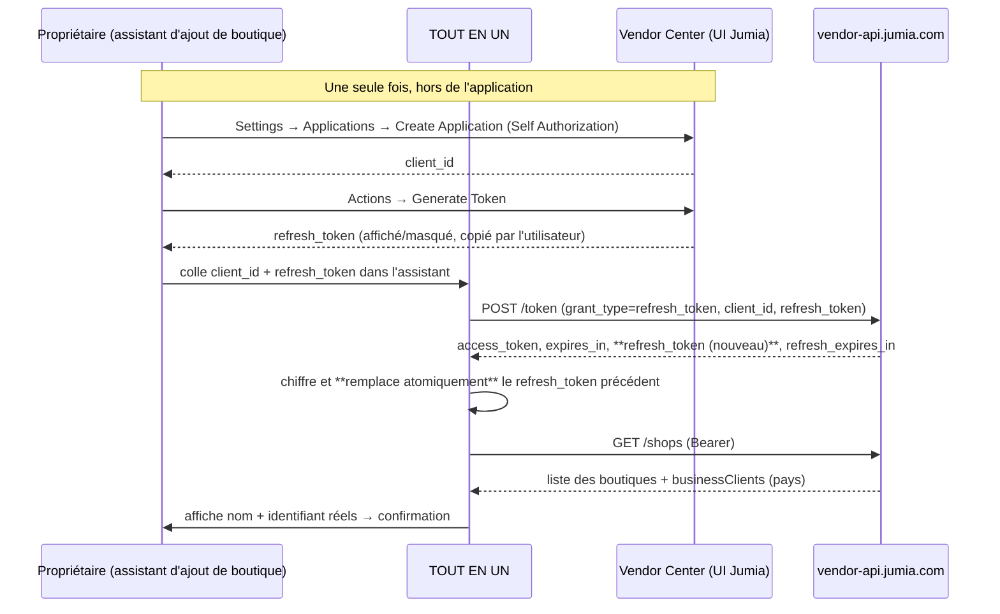

# Intégration Jumia — étude de l'API officielle

> Phase 0. Sources : **spécification OpenAPI officielle** `https://vendorcenter.jumia.com/api-docs/openapi.yaml` et ses fichiers liés, récupérée le **2026-11-10** et archivée dans `docs/reference/jumia-openapi/` (33 fichiers, 328 Ko). Version de la documentation : GPM/GOP **v2.0 datée du 2026-08-11**, compléments du **2026-09-16** (`shippingDate`/`statusDetail` sur les items).
> Convention de ce document : **[C]** = confirmé par la spécification officielle · **[I]** = inconnu, à vérifier · **[X]** = impossible via l'API.

---

## 1. Deux API différentes : ne pas se tromper

| | **Vendor Center API** (à utiliser) | **Seller Center API** (ancienne) |
|---|---|---|
| Hôte | `https://vendor-api.jumia.com` (staging : `https://vendor-api-staging.jumia.com`) | `https://sellercenter-api.jumia.<pays>` |
| Authentification | **OAuth 2.0**, `Authorization: Bearer <access_token>` **[C]** | signature HMAC-SHA256 de paramètres triés (UserID + API key) |
| Format | JSON **[C]** | XML/JSON |
| Multi-pays | **un seul compte couvre tous les pays du Mastershop** **[C]** | une URL et une clé par pays |
| Documentation | `vendorcenter.jumia.com/api-docs/` **[C]** | `sellerapi.sellercenter.jumia.com` |

**Décision.** Nous intégrons **uniquement la Vendor Center API**, pour quatre raisons : (1) c'est la seule API activement maintenue (corrections publiées en août/septembre 2026) ; (2) elle donne accès aux `payout-statement`, indispensable pour un bénéfice **confirmé** ; (3) un seul jeu d'identifiants couvre N pays, ce qui correspond au multi-boutiques demandé ; (4) l'authentification OAuth2 avec jetons rotatifs est compatible avec un serveur non supervisé.
**Conséquence.** L'ancienne API n'est pas implémentée en P2. Si un besoin spécifique apparaissait (un endpoint absent de la Vendor API), il ferait l'objet d'une décision séparée, jamais d'un contournement silencieux.

---

## 2. Authentification (OAuth 2.0) — **[C]**

### 2.1 Type d'application : **Self Authorization** (obligatoire pour nous)

| | Self Authorization | Web Application |
|---|---|---|
| Usage | intégration sans personne devant l'écran (ERP, cron) | nécessite un humain pour se connecter |
| Identifiants reçus | `client_id` + `refresh_token` généré dans l'interface | `client_id`, `client_secret`, `redirect_uri` |
| `grant_type` | `refresh_token` | `authorization_code` |
| Retourne un `refresh_token` ? | **oui, un nouveau à chaque appel** | **jamais** |

Le type **ne peut pas être changé après création** de l'application. Une erreur de choix impose de recréer une application.

### 2.2 Flux retenu



**Étape utilisateur assumée.** La création de l'application et la génération du `refresh_token` se font dans l'interface Jumia : aucune API ne permet de les automatiser **[X]**. C'est le **seul** point où l'utilisateur touche à un identifiant technique, et l'assistant le guide pas à pas avec captures. Une fois fait, plus aucune intervention n'est nécessaire (tant que le refresh token est valide).

### 2.3 `POST /token` **[C]**

- `Content-Type: application/x-www-form-urlencoded`
- corps (Self Authorization) : `grant_type=refresh_token`, `client_id`, `refresh_token` (**pas de `client_secret`**)
- réponse : `access_token`, `token_type` (`Bearer`), `expires_in`, `scope`, `id_token`, **`refresh_token`**, **`refresh_expires_in`**
- erreurs au format OAuth : `{ error, error_description }` — `400 unauthorized_client`, `400 invalid_grant`, `401 invalid_client`

**Durées.** Non publiées : le document officiel précise explicitement que `expires_in` et `refresh_expires_in` sont **configurables** et qu'il ne faut **pas** coder de durée en dur. **[C]**

### 2.4 Rotation et concurrence — le point le plus dangereux **[C]**

Chaque `/token` **invalide le refresh token utilisé** et en renvoie un nouveau. Deux conséquences directes :

1. **Un seul renouvellement à la fois par application Jumia.** Deux workers qui renouvellent en parallèle : l'un des deux repart avec un jeton déjà invalidé → `invalid_grant` → **boutique définitivement déconnectée** jusqu'à une nouvelle génération manuelle.
2. **Écriture atomique obligatoire.** Le nouveau jeton doit être écrit avant que la réponse ne soit perdue.

**Implémentation retenue** (décrite en détail en P1, testée en P2) :

```
BEGIN;
  SELECT pg_advisory_xact_lock(hashtext('marketplace_app:' || app_id));   -- verrou global par application
  SELECT refresh_token_… FOR UPDATE;                                      -- relecture du jeton courant
  IF access_token valide (expires_at > now() + marge de 5 min) THEN
     ROLLBACK; RETURN access_token;                                       -- aucun renouvellement inutile
  END IF;
  réponse = POST /token (refresh_token courant)
  UPDATE marketplace_apps SET refresh_token = réponse.refresh_token,      -- remplacement atomique
         access_token = …, expires_at = now() + expires_in,
         refresh_expires_at = now() + refresh_expires_in, key_version = …
  INSERT token_refresh_log (outcome, durée, expires_in)                   -- jamais de valeur de jeton
COMMIT;
```
- **Marge** : renouvellement 5 minutes avant `expires_in` (paramétrable), jamais de renouvellement à chaque requête.
- **Filet de sécurité** : table `token_refresh_log` + alerte à J-7 sur `refresh_expires_at` (le refresh token lui-même expire) → notification « Reconnexion nécessaire » **avant** la panne.
- **Diagnostic** : si `invalid_grant` survient malgré le verrou (jeton régénéré depuis l'interface Jumia, autre outil l'ayant consommé), statut `reauth_required` + assistant de reconnexion. Aucune boucle de retry infinie sur `invalid_grant` (retry immédiat interdit, code classé non-retryable).
- **Tests exigés en P2** : deux processus concurrents sur le même `/token` (le second doit lire le jeton déjà mis à jour et ne pas appeler l'API) ; coupure entre l'appel HTTP et le COMMIT (le jeton doit être rejouable ou l'état `reauth_required` doit être explicite) — cas documenté comme limite.

---

## 3. Limites de débit **[C]**

> « This rate limit is going to be applied at **Mastershop level**. In a first stage, the limits will be **200 requests/minute with a limit of 4 requests/second**. »

Conséquences de conception :

| Mesure | Implémentation |
|---|---|
| Débit global | limiteur **par application** (donc par Mastershop) : 4 req/s et 200 req/min, jeton-bucket en base (`api_rate_buckets`) partagé entre `web` et `worker` → ne jamais dépasser même avec plusieurs processus |
| Parallélisme | 2 requêtes concurrentes maximum par application ; sérialisation des jobs d'une même boutique |
| 429 | lecture de `Retry-After` s'il est présent, sinon backoff exponentiel avec jitter (1 s → 2 → 4 → … max 5 min), plafonné à 6 tentatives, puis `sync_errors` + statut `partial` |
| 5xx / timeouts | retry (max 3), puis échec consigné |
| 4xx métier | **pas de retry** (sauf 429) ; message consigné tel quel |
| Fenêtre de synchronisation | étalement des boutiques : un job par boutique, décalé ; jamais 100 boutiques en même temps |
| Budget | au démarrage, une sync initiale de 100 boutiques est étalée (voir §6.4) car 200 req/min est vite atteint |

**[I]** Le `Retry-After` et d'éventuels en-têtes `X-RateLimit-*` ne sont pas documentés : à observer sur des réponses réelles en P2, puis à consigner ici.

---

## 4. Ressources disponibles — inventaire honnête

### 4.1 Cartographie **[C]**

| Domaine | Endpoint | Pagination | Usage dans l'application |
|---|---|---|---|
| Boutiques | `GET /shops` | aucune (liste courte) | identification réelle de la boutique, pays/devises |
| Boutiques | `GET /shops-of-master-shop` | aucune | découverte de toutes les boutiques du compte |
| Catalogue | `GET /catalog/products` | **curseur** (`token`, `nextToken`, `isLastPage`), `size` 1–100 | import/MAJ des produits (SID, SKU, statut, QC, prix, visibilité) |
| Catalogue | `GET /catalog/brands`, `GET /catalog/categories`, `GET /catalog/attribute-sets/{id}` | — | référentiels pour la fiche produit MIMI |
| Stocks | `GET /catalog/stock` | curseur, `size` 1–100 | **stock Jumia** (`globalStock`) — source de vérité |
| Stocks | `GET /catalog/stock/salesorderitem/{orderItemSid}?status=PENDING\|SHIPPED\|CANCELED` | — | rapprochement d'un mouvement de stock avec l'item qui l'a causé (nouveau en v2.0) |
| Commandes | `GET /orders` | **curseur** (`token`), `size` ≤ 300, `isLastPage` | liste des commandes, filtres `status`, `country`, `shopId`, `createdAfter/Before`, `updatedAfter/Before` |
| Commandes | `GET /orders/items?orderId=…` | non paginé (1 commande à la fois) | lignes de commande (prix, `paidPrice`, frais, `exchangeRate`, retours/QC) |
| Commandes | `GET /orders/shipment-providers?orderItemId=…` | — | transporteurs, `trackingCodeRequired` |
| Commandes | `POST /v2/orders/pack` | — | marquer emballé (+`trackingCode`) |
| Commandes | `POST /orders/ready-to-ship`, `POST /orders/print-labels`, `POST /orders/cancel` | — | préparation, étiquettes PDF (base64), annulation |
| Produits (écriture) | `POST /feeds/products/create`, `/update`, `/stock`, `/price`, `/status` | — | écritures **asynchrones** via « feeds », ≤ 1000 lignes par requête |
| Suivi d'écriture | `GET /feeds/{id}` | — | statut du feed : `PENDING`, `IN_PROGRESS`, `COMPLETED`, `FAILED` + erreurs par ligne |
| Finance | `GET /payout-statement` | `page`/`size` (≤ 1000), `currency=LOCAL\|USD` | **relevés de paiement : la base du bénéfice confirmé** |
| Consignation | `POST/PATCH /consignment-order`, `GET /consignment-stock` | — | réapprovisionnement des entrepôts Jumia (Jumia Express) |

### 4.2 Champs utiles confirmés

**Produit** : `id` (SID), `sellerSku`, `parentSku`, `name`, `description`, `brand{code,name}`, `category{code,name}`, `additionalCategories[]`, `images[]` (`url`, `primary`), `attributeSetId`, `attributes[]`, `variations[]`, `barcodeEan`, `createdAt`, `updatedAt`, `globalPrice{currency,value,salePrice}`, `businessClients[]{code, price{localValue,localCurrency,currency,salePrice}, status, statusUpdatedAt, visible}`.
Statuts produit : `ACTIVE`, `INACTIVE`, `DELETED` (filtrables : `ACTIVE`/`INACTIVE` seulement) ; QC : `NOT_READY_TO_QC`, `PENDING`, `APPROVED`, `REJECTED`.

**Commande** : `id`, `number`, `shopIds[]`, `status`, `totalItems`, `packedItems`, `isPrepayment`, `hasMultipleStatus`, `hasItemsFulfilledByJumia`, `pendingSince`, `deliveryOption`, `totalAmount{currency:'USD', value}`, `totalAmountLocal{currency, value}`, `country{code,name,currencyCode}`, `shippingAddress{…}`.
Statuts d'item : `PENDING`(1), `SHIPPED`(2), `CANCELED`(3), `RETURNED`(4), `FAILED`(5), `DELIVERED`(6), `READY_TO_SHIP`(8). **Pas de statut `ALL`** : on omet le paramètre. Filtres `status` et `country` = listes séparées par des virgules ; `country` ∈ `CI, DZ, EG, GH, KE, MA, NG, SN, TN, UG, ZA` (**pas CM ni TZ**).

**Ligne de commande** : `id`, `shopId`, `status`, `statusDetail` (retours/QC : `reason`, `damageResponsibility`, `damageLevelReason`, `issueVerificationComments`), `itemPrice`, `paidPrice`, `shippingAmount`, **+ versions `*Local`**, `exchangeRate`, `taxAmount`, `voucherAmount`, `product{sellerSku,imageUrl}`, `shippingAddress`, `shippedDate`, `trackingNumber`, `isFulfilledByJumia`.

**Relevé de paiement** : `statementNumber`, `shopSid`, `createdAt`/`updatedAt`, `openingBalance`, `itemRevenue`, `shipmentFee`, `shipmentFeeCredit`, `otherRevenueTotal`, `feesTotal`, `subtotal1`, `refunds`, `feesOnRefundsTotal`, `subtotal2`, `closingBalance`, `guaranteeDeposit`, `payout{amount,currency}`, `paid`, `paymentReference`, `subsidy`, `subsidyRefund`.

### 4.3 Ce qui est **impossible** ou **absent** de l'API **[X]**

| Besoin | Constat | Conséquence |
|---|---|---|
| **Factures officielles Jumia** (document PDF par commande) | **Aucun endpoint** dans la spécification. Les seuls documents produits par l'API sont les **étiquettes d'expédition** (`POST /orders/print-labels`, PDF en base64). | Voir §7 : statut « Indisponible » + import autorisé depuis Vendor Center, archivé avec empreinte |
| Relevé détaillé **par commande** (répartition des commissions par ligne) | Le `payout-statement` est **agrégé par boutique et par période**, pas par commande | Commissions par commande = **estimées** (formules validées) ; agrégat = **confirmé** |
| Notifications temps réel (webhooks) | **Aucun webhook** documenté | Synchronisation par interrogation (cron) ; **[I]** à confirmer auprès du compte Jumia |
| Suppression d'un produit | Pas d'endpoint de suppression ; `feeds/products/status` permet de passer `INACTIVE` | « Suppression » locale uniquement + désactivation chez Jumia après validation |
| Documents/images produit à récupérer en masse | URLs présentes ; pas d'endpoint binaire | Téléchargement HTTP direct des URLs d'images (avec contrôle de type et de taille) |
| Messages clients / questions produits | Absents de l'API | Fonctionnalité **non proposée** (pas de bouton décoratif) |
| Prix d'achat, coûts | Évidemment absents | Saisie locale (`cost_history`) |
| Devis/retours détaillés (remboursements ligne à ligne) | `refunds` agrégé au relevé ; `statusDetail` par item pour la raison du retour | Rapprochement par item limité à ce que l'API expose — documenté comme tel |

### 4.4 Points à vérifier sur données réelles (P2) **[I]**

1. Sémantique exacte de `itemPrice` vs `paidPrice` vs `voucherAmount` (qui paie la remise) — influe sur le calcul de marge.
2. `globalStock` : stock **global** au Mastershop ou par business client ? La spécification dit « Global stock for the product ». À vérifier avec un produit publié dans plusieurs pays.
3. Identité des soldes du relevé : `subtotal2` inclut-il `feesOnRefundsTotal` ? `closingBalance` = `openingBalance + subtotal2 − guaranteeDeposit − payout.amount` ? **À valider sur 2–3 relevés réels** avant d'implémenter les formules « confirmées ».
4. Date/heure des champs `createdAt` (Jumia) : fuseau appliqué (UTC ? heure locale du pays ?). La spec dit « not ISO-8601 » sans préciser le fuseau.
5. Comportement de `/orders` sans filtre : « retourne les commandes **créées aujourd'hui** » — quel fuseau pour « aujourd'hui » ?
6. `Retry-After` / en-têtes de quota sur 429.
7. Limite réelle du nombre de boutiques par Mastershop (le document parle de « moins de 100 » pour `/shops-of-master-shop`).
8. Existence d'un environnement **staging** utilisable avec de vraies données (l'URL existe : `vendor-api-staging.jumia.com` + `vendorcenter-staging.jumia.com`).

---

## 5. Assistant d'ajout de boutique (parcours exact)

| Étape | Écran | Contrôles serveur |
|---|---|---|
| 1 | Nom personnalisé | non vide, ≤ 60 caractères, unicité par utilisateur |
| 2 | Authentification officielle : `client_id` + `refresh_token` (guidage pas à pas vers Vendor Center) | format, chiffrement immédiat, **jamais renvoyé au navigateur** (test automatisé) |
| 3 | Vérification des autorisations | `POST /token` puis `GET /shops` ; erreur `invalid_client`/`invalid_grant` → message actionnable, aucun identifiant n'est stocké si l'appel échoue |
| 4 | Récupération des identifiants réels | liste des `businessClients` (pays) ; sélection du pays si plusieurs |
| 5 | Confirmation d'identité | affichage **nom Jumia + SID + pays + devise** renvoyés par l'API ; l'utilisateur coche « c'est bien ma boutique » ; refus si `(sid, business_client)` existe déjà |
| 6 | Première synchronisation | job `initial` (produits puis stocks puis commandes fenêtre 90 j) ; écran de progression avec compteurs réels ; possibilité de quitter (job en arrière-plan) |

**Aucune saisie d'URL, de pays, de devise ou d'identifiant interne** : tout vient de l'API. Le seul choix est le `client_id`/`refresh_token` (obligatoire côté Jumia) et le nom d'affichage.

---

## 6. Stratégie de synchronisation

### 6.1 Modèle par (boutique, ressource)

| Ressource | Mode initial | Mode périodique | Incrémental ? | Fenêtre |
|---|---|---|---|---|
| `products` | curseur complet | 60 min | oui (`createdAtFrom`/`createdAtTo`, `latestFirst`) | complet au départ, puis delta |
| `stock` | curseur complet | 15 min | non (pas de filtre date) → complet, curseur, ≤ 100/page | n/a |
| `orders` | 90 jours | 10 min | **oui** via `updatedAfter`/`updatedBefore` | **≤ 3 mois** par requête (limite API) |
| `order_items` | à la demande pour chaque commande nouvelle/modifiée | idem | oui | n/a |
| `payout_statements` | 90 jours (défaut API) ou historique complet à la demande | 1×/jour | oui (`createdAfter`) | n/a |
| référentiels (`categories`,`brands`) | complet | 1×/semaine | n/a | n/a |

### 6.2 Pagination et reprise **[C]**

`GET /orders`, `/catalog/products`, `/catalog/stock` utilisent un **curseur opaque** : la réponse contient `nextToken` et `isLastPage`. Règles :

- `size` = 100 pour produits/stock, 200 pour commandes (max 300) — ajustable selon les mesures réelles.
- Chaque page est traitée dans **une transaction** : `upsert` des données + mise à jour de `sync_cursors.cursor` + incrément des compteurs de `sync_runs`. Commit. Puis page suivante.
- Coupure brutale → au redémarrage, on repart du curseur commité. **Aucune page sautée, aucune page dupliquée** (l'upsert rend le doublon inoffensif de toute façon).
- Un curseur Jumia peut expirer **[I]** : si l'API refuse un curseur, on repart du début de la fenêtre en mode `reconciliation` et on le consigne (statut `partial` jusqu'à la fin).
- `synced` exige `isLastPage = true` **et** zéro erreur non résolue. Sinon `partial` avec les compteurs exacts.

### 6.3 Idempotence

`INSERT … ON CONFLICT (shop_id, external_id) DO UPDATE SET …` pour produits, commandes, items, stocks, relevés. Le test « exécuter deux fois la même synchronisation » doit produire `items_created = 0` au second passage.

### 6.4 Verrous

- Verrou consultatif PostgreSQL `pg_try_advisory_xact_lock(hashtext('sync:'||shop_id||':'||resource))` : si non obtenu → le job se termine en `skipped` (visible dans l'historique, jamais silencieux).
- `sync_locks` fournit la visibilité (qui, depuis quand) ; heartbeat toutes les 30 s ; verrou orphelin (> 10 min sans heartbeat) levé et consigné.
- **Budget de démarrage** : 100 boutiques × (produits + stocks + 90 j de commandes) → planification étalée avec un débit cible de 120 req/min (60 % du plafond), soit une estimation à calculer après mesure du nombre de pages réel (à faire en P2 avec 2–3 boutiques réelles).

### 6.5 Statuts et écran Jumia Connect

Statuts de boutique : `connected` · `syncing` · `synced` · `partial` · `error` · `reauth_required` · `disabled`.
Écran : boutiques nécessitant une intervention en tête ; par boutique : dernière sync réussie par ressource, compteurs (lus/créés/mis à jour/ignorés/en erreur), durée, prochaine exécution, boutons **Relancer**, **Reprendre** (depuis le curseur), **Reconnecter**, **Voir les erreurs** (avec `http_status`, code, nombre d'occurrences).

### 6.6 Contrôle de cohérence (réconciliation)

Job quotidien par boutique : compare un échantillon + les agrégats (nombre de commandes de la veille, somme des `itemRevenue` du relevé vs somme des ventes locales, stock Jumia vs stock local attendu). Écarts → `reconciliation_findings` avec `expected`/`actual`. **Aucune correction automatique** : l'écran propose une action, l'utilisateur valide, l'action est journalisée.

---

## 7. Factures et documents officiels — position honnête

| Type de document | Disponibilité via API | Ce que fait l'application |
|---|---|---|
| **Facture officielle Jumia** (par commande) | **Indisponible [X]** — aucun endpoint | Statut affiché : **« Indisponible via l'API Jumia »**. Aucune facture n'est fabriquée. Un import manuel depuis Vendor Center est proposé : le fichier est stocké tel quel, `is_official = true`, `origin = user_upload`, `external_ref` saisi/confirmé par l'utilisateur, empreinte SHA-256 calculée, historique de récupération conservé |
| **Relevé de paiement** | **Disponible [C]** (`/payout-statement`) | Archivé en JSON brut signé par empreinte + restitution lisible ; **jamais** modifié |
| **Étiquette d'expédition** | **Disponible [C]** (`/orders/print-labels`, PDF base64) | Archivée, `kind = shipping_label`, une ligne par étiquette, liée à la commande |
| **Document interne** (bon de livraison, facture proforma, etc.) | généré par nous | Toujours `is_official = false` + mention **« Document interne — non officiel »** en en-tête, en pied et dans le nom de fichier ; un test vérifie qu'aucun document non officiel n'est présenté comme « Facture Jumia » |
| **Bon de commande fournisseur** | n/a (interne) | Généré, versionné, joint aux achats |

**Recherche d'une méthode officielle pour les factures.** Question à poser au compte Jumia / account manager (voir `docs/questions-ouvertes.md`) : existe-t-il un endpoint ou un accès documentaire officiel hors spécification publique ? Tant que la réponse est non, on n'invente rien.

**Hash d'intégrité.** `sha256` calculé à l'octet près sur le contenu stocké (pas sur le base64), revérifié par un job mensuel (`integrity_checked_at`, `integrity_ok`) ; un écart crée un incident critique et bloque le téléchargement avec un avertissement explicite.

---

## 8. Détection des doublons et vue consolidée

**Clé de dédoublonnage (documentée)** :

| Entité | Clé de doublon inter-boutiques | Règle |
|---|---|---|
| Commande | `(jumia_shop_sid, order_number)` | une commande appartient à **une** boutique ; la même commande ne peut pas apparaître dans deux boutiques. En vue « Toutes les boutiques », on agrège les lignes, il n'y a donc pas de double comptage |
| Ligne de commande | `order_item.id` (UUID Jumia) | identifiant unique global ; un item ne compte qu'une fois |
| Produit | `(shop_id, seller_sku)` + `external_id` | un même SKU dans deux boutiques = **deux produits distincts** (stocks et prix différents) → comptés séparément, jamais fusionnés |
| Relevé | `(shop_id, statement_number, currency_requested)` | un relevé n'est compté qu'une fois |
| Paiement | `paymentReference` | si deux relevés portent la même référence, alerte de doublon |

**Règle de priorité des sources**, par ordre décroissant : (1) API Jumia (produits, commandes, stocks, relevés) · (2) import de fichier (facture/relevé manuel) · (3) saisie manuelle. Une donnée saisie manuellement ne remplace jamais une donnée API ; elle la complète (ex. coût d'achat) ou est signalée en conflit.

**Contrôle anti-double-comptage** : test automatisé sur un jeu où la même commande est présente dans deux payloads de sync → une seule ligne ; et un test d'agrégat : somme des boutiques = total de la vue consolidée à l'unité mineure près.

---

## 9. Écritures chez Jumia (P2 : aucune ; P3 : propositions validées)

Rien ne s'écrit chez Jumia sans **validation explicite** de l'utilisateur, et toute écriture passe par un **feed asynchrone** dont on suit le statut :

`proposal` (avant/après, périmètre, impact) → confirmation → `POST /feeds/products/{stock|price|status}` (≤ 1000 lignes) → `feed_id` stocké → polling `GET /feeds/{id}` jusqu'à `COMPLETED`/`FAILED` → résultat par ligne consigné (`productSid`, `sellerSKU`, `errorMessage`) → audit.

Contrainte forte : **seuls les produits dont le QC status est `APPROVED` au moins une fois** peuvent recevoir des mises à jour de stock/prix/statut **[C]**. L'interface indique explicitement les produits exclus pour cette raison (cause, pas « échec inconnu »).

---

## 10. Ce qui sera testé en Phase 2 (et ce qui ne pourra pas l'être)

**Testable sans identifiants Jumia** (mocks HTTP enregistrés, contrat figé à partir de la spec archivée) : pagination complète, reprise après interruption, idempotence, concurrence de renouvellement, 429/backoff, mapping des champs, isolation multi-boutiques, statut `partial`.

**Testable uniquement avec accès réel** : OAuth de bout en bout, débit réel, expiration du refresh token, contenu réel de `globalStock`, identités comptables des relevés, existence d'un webhook, production de PDF d'étiquettes.

**Sans accès réel, la Phase 2 ne pourra pas être déclarée terminée** au sens de la Définition de Terminé. C'est un prérequis, pas une option (question ouverte n°2).
