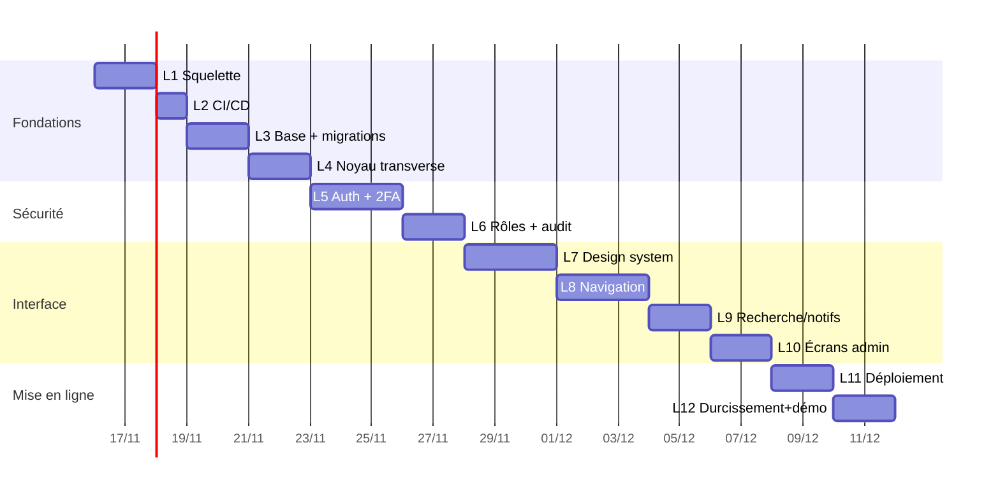

# Plan détaillé de la Phase 1 — Fondations et coquille UI

> Phase 0 → à valider avant démarrage. Ce plan est exécutable tel quel : chaque lot a un périmètre fermé, des critères d'acceptation mesurables et un livrable vérifiable.
> Estimations en **jours de travail effectifs** (1 lot = 0,5 à 3 j), pas en jours calendaires.

---

## 1. Objectif et périmètre

**Objectif.** À la fin de la P1 : l'application est en ligne sur son URL définitive en HTTPS, on peut s'y connecter avec 2FA, gérer des utilisateurs et des rôles, se déplacer dans une interface complète (navigation, sélecteur de boutique, recherche, notifications), et **tout est journalisé**. Il n'y a **aucune donnée Jumia** : c'est normal et assumé, l'interface le dit.

### Dans le périmètre
- Projet, CI/CD, environnements, URL permanente, PWA installable.
- Base de données initiale (identité, boutiques, audit, notifications, agrégats vides) + migrations versionnées + RLS.
- Authentification (email/mot de passe, sessions, 2FA TOTP, verrouillage), rôles et permissions serveur.
- Design system (jetons, thèmes clair/sombre, 20 composants), atelier `/ui`.
- Coquille complète : sidebar 2 niveaux clavier-accessible, barre supérieure, sélecteur de boutique, recherche globale, centre de notifications, actions rapides, profil.
- Écrans réels mais **sans données métier** : connexion/2FA, Toutes les boutiques (liste vide + état vide utile), Administration (utilisateurs, rôles, journal d'audit), Paramètres, Système (Propriétaire), Jumia Connect (coquille : aucun bouton actif qui n'ait d'effet).
- Journal d'audit en ajout seul + exports neutralisés (utilisateurs, audit).
- Sauvegarde automatique + **restauration testée**.

### Hors périmètre (assumé, affiché « Bientôt » ou absent)
Connexion Jumia réelle, synchronisations, produits, commandes, stocks, finance, rapports chiffrés, MIMI, entrepôts, retours. **Toutes les entrées de menu correspondantes existent en `soon`** (désactivées, sans action), sauf celles qui n'ont aucun sens sans données (aucune page vide n'est créée pour « faire joli »).

---

## 2. Prérequis de votre côté (bloquants)

| # | Prérequis | Utilisé par | Sans lui |
|---|---|---|---|
| 1 | Nom de domaine + accès DNS | L1, L11 | staging et prod sur IP uniquement, HTTPS impossible → P1 non conforme |
| 2 | VPS (2 vCPU / 4 Go min, Debian 12) + accès SSH | L1, L11 | idem |
| 3 | Dépôt GitHub + droit d'ajouter des secrets Actions | L2, L11 | CI locale seulement |
| 4 | Serveur SMTP (transactionnel) + adresse d'envoi | L5, L8 | notifications e-mail et invitations inopérantes |
| 5 | Réponses aux questions de `docs/questions-ouvertes.md` n°1 (périmètre pays/devise) | L3 (devise de référence), L4 | paramétrage par défaut provisoire, à ne pas figer |
| 6 | Validation de `docs/formules-financieres.md` | L12 (paramètres) | les écrans financiers restent absents |

**Aucun de ces prérequis ne bloque le code** : L2 à L10 se développent sans eux, L1/L11 se finalisent quand ils arrivent. La P1 ne peut pas être déclarée *Terminée* sans 1, 2, 3, 4.

---

## 3. Lots de travail

### L1 — Squelette du projet et outillage (1,5 j)
- `create-next-app` (App Router, TS strict, `noUncheckedIndexedAccess`, `exactOptionalPropertyTypes`), `pnpm`, ESLint 9 + Prettier, `tsc --noEmit`, Vitest, Playwright, `docker-compose.dev.yml` (PostgreSQL 16).
- Structure `src/core`, `src/modules`, `src/ui`, `tests/`, `drizzle/`, `scripts/`.
- Règles de frontières inter-modules (`no-restricted-imports`), interdiction des couleurs en dur, interdiction de `number` pour les montants (type `Money`).
- `.env.example` complet, `README.md` de démarrage, `docs/` présent.
- **Acceptation** : `pnpm lint && pnpm typecheck && pnpm test && pnpm build` passent sur un clone vierge ; `docker compose -f docker-compose.dev.yml up` donne une base prête.

### L2 — CI GitHub Actions (0,5 j)
- Pipeline : lint → typecheck → tests unitaires → tests d'intégration (PostgreSQL éphémère via service container) → vérification des migrations (up/down sur base vide + `EXPECT_NO_DRIFT`) → build → E2E (Playwright, 3 scénarios fumée) → `pnpm audit --audit-level=high` → job bloquant.
- Cache pnpm, artefacts de rapport, protection de branche, modèle de PR, `CHANGELOG.md` + SemVer.
- **Acceptation** : une PR qui casse un test, le typage ou une migration ne peut pas être fusionnée ; durée du pipeline < 8 min.

### L3 — Base de données et migrations (2 j)
- Migrations `0001` → `0009` (voir `docs/database.md` §8), chacune avec `down` testé.
- Seed `demo` (2 utilisateurs, 3 boutiques **fictives**, aucune donnée Jumia), refus d'exécution en production.
- Client Drizzle + `scoped.ts` (injection obligatoire du `ShopScope`), `SET LOCAL app.shop_id`.
- RLS activée + **tests de garde-fou CI** (tables scopées sans policy, requêtes sans `shop_id`).
- **Acceptation** : base vide → migrations → rollback → migrations, sans erreur ; test d'isolation à deux boutiques homonymes vert ; un `SELECT` non scopé échoue en test.

### L4 — Noyau transverse (1,5 j)
- `money.ts` (`Money`, unités mineures, exposants, `fromApiAmount`, allocation au plus fort reste) + tests F-01 à F-04, F-17.
- `crypto.ts` (enveloppe AES-256-GCM, ring de clés, AAD) + tests (déchiffrement, mauvaise clé, altération du tag, rotation).
- `logger.ts` (pino, redaction, `request_id`), `errors.ts` (erreurs typées, messages utilisateur vs techniques), `validation.ts` (Zod + helper de Server Action), `rateLimit.ts`.
- `app.config.ts` : **NOM OFFICIEL** en une seule constante + test qui échoue si le nom est dupliqué en dur ailleurs.
- **Acceptation** : tests de crypto et de money verts ; aucun secret dans un log (test par injection d'un faux jeton dans tous les chemins d'erreur).

### L5 — Authentification, sessions, 2FA (3 j)
- Inscription **désactivée par défaut** (création par le Propriétaire), mot de passe Argon2id, politique de robustesse, verrouillage progressif, réinitialisation par le Propriétaire avec jeton à usage unique.
- Sessions : cookie opaque haché, expiration glissante 12 h, liste des appareils, révocation, déconnexion globale.
- 2FA TOTP obligatoire Propriétaire/Gestionnaire (enrôlement avec QR **généré localement**, vérification, codes de secours hachés, déverrouillage), non désactivable par l'utilisateur concerné sans l'intervention d'un Propriétaire.
- CSRF (double-submit + contrôle d'origine), en-têtes de sécurité, CSP à nonce.
- **Acceptation** : parcours complet testé en E2E ; 6 tests d'attaque (rejeu de session, fixation, CSRF, force brute, contournement 2FA, cookie volé/révoqué) échouent tous ; `axe` sans violation sur les écrans d'auth.

### L6 — Rôles, permissions, journal d'audit (2 j)
- 5 rôles système, permissions par module × action, rôles par boutique (`user_roles.shop_id`), matrice d'accès affichée et modifiable par le Propriétaire (dans les limites des rôles système).
- `authz()` serveur appliqué à **chaque** Server Action et route ; tests générés : pour chaque permission × rôle, l'accès attendu est vérifié (une table de cas, pas un test manuel).
- `audit_log` : écriture dans la même transaction que la mutation, triggers d'immuabilité, écran de consultation avec filtres (utilisateur, boutique, module, période) et comparaison avant/après.
- **Acceptation** : aucune action ne modifie une donnée sans ligne d'audit (test par échantillonnage automatique des services) ; tentative de mise à jour/suppression d'une ligne d'audit → exception ; un Gestionnaire ne peut pas accéder aux paramètres système (test serveur, pas seulement UI).

### L7 — Design system et composants du socle (3 j)
- Jetons CSS, thèmes clair/sombre (préférence appareil + mémorisation), Inter auto-hébergée, 20 composants du §3 de `design-system.md`, atelier `/ui` (protégé, non indexé).
- Pastilles de provenance, `FreshnessNote`, `Banner`, `Skeleton`, `EmptyState`, `ErrorState` — **imposés par le socle**, pas optionnels.
- Tests : rendu, clavier, `axe`, contraste des jetons, `prefers-reduced-motion`.
- **Acceptation** : aucune violation `axe` `serious`/`critical` ; navigation clavier complète sur l'atelier ; aucun hex en dur hors `tokens.css` (lint).

### L8 — Coquille de navigation (3 j)
- `navigation.config.ts` complet (8 modules, 44 entrées, permissions, `availability`, badges) + test de cohérence routes ↔ config + test « pas d'entrée sans permission ».
- Sidebar 2 niveaux : ouverture multiple, mémorisation, Tout ouvrir/fermer, chevrons, page active auto-ouverte, clavier complet, mode icônes (bureau), tiroir (mobile).
- Barre supérieure : logo, sélecteur de boutique, recherche, actions rapides, notifications, profil.
- Sélecteur de boutique : recherche, groupes par statut/plateforme, virtualisation, « Toutes les boutiques », filtrage **serveur** via `?shop=`, périmètre actif visible en permanence, contrôle d'autorisation serveur.
- **Acceptation** : démonstration clavier + souris + mobile ; test Playwright : aucun débordement horizontal à 375 px ; sélection de boutique conservée à travers 6 pages ; 100 boutiques de test (seed) affichées sans dégradation (> 2 s ⇒ échec).

### L9 — Recherche globale, notifications, actions rapides (2 j)
- Recherche : palette `Ctrl/Cmd+K`, requêtes `pg_trgm`/`tsvector` sur boutiques/utilisateurs/audit en P1, groupées, filtrées par scope, 5 max par catégorie, états vide/chargement.
- Notifications : types du prompt, regroupement (`group_key`), lu/non lu, filtres, lien direct, e-mail pour les incidents critiques (via SMTP).
- Actions rapides : menu de 7 entrées, chacune soit ouvre le vrai formulaire, soit `soon` désactivée — **jamais un bouton mort**.
- **Acceptation** : un utilisateur restreint à une boutique ne trouve aucun résultat hors périmètre (test serveur) ; notification d'incident → e-mail reçu en staging ; aucune entrée d'action rapide sans destination.

### L10 — Écrans administratifs et Système (2 j)
- Utilisateurs (création par invitation, statut, rôles, accès boutiques), Rôles (matrice), Journal d'activité (filtres + export), Paramètres (général, fuseau, devise, notifications, apparence), Système (version, env, état base/file, latence, compteurs, tâches en attente, erreurs, `/api/health/deep`).
- **Toutes les boutiques** : page réelle, cartes réduites/dépliées avec agrégats « — » (aucune donnée Jumia), états vide/erreur, filtres/tri.
- Exports Excel/CSV/PDF de ces écrans avec en-tête de périmètre/période/date et neutralisation des formules.
- **Acceptation** : exports testés avec des valeurs hostiles (`=cmd`, `+1`, `@x`) neutralisées ; écran Système cohérent avec `/api/health/deep` ; aucune page n'affiche `0` là où la donnée est absente.

### L11 — Déploiement, URL permanente, sauvegardes, restauration (2 j)
- `docker-compose.yml` prod (caddy, web, worker, postgres, backup), `Dockerfile` multi-étapes non-root, healthchecks, `Caddyfile` (TLS auto, HSTS, en-têtes), staging **séparé** (base et secrets distincts).
- Secrets injectés hors dépôt ; `APP_ENC_KEYS` monté en fichier.
- Sauvegarde chiffrée quotidienne hors serveur + script de restauration + **job de test de restauration** hebdomadaire avec contrôle d'intégrité ; procédure de rollback documentée et **exécutée une fois pour de vrai**.
- `docs/deploiement.md`, `docs/sauvegarde-restauration.md`, `docs/ci-cd.md`, `docs/maintenance.md`.
- **Acceptation** : URL permanente en HTTPS (A+ sur un contrôle de configuration TLS), redéploiement sans changement d'URL, restauration d'un dump dans une base jetable avec comptages identiques, rollback d'une version N → N-1 sans perte.

### L12 — Durcissement, documentation, démonstration (1,5 j)
- Revue de sécurité interne (checklist OWASP ASVS niveau 1), tests de permissions exhaustifs, tests de charge légers (100 boutiques de démonstration).
- `docs/guide-utilisateur.md` (français, captures), mise à jour de tous les documents, `CHANGELOG.md`.
- Préparation de la démonstration de validation et du compte rendu au format imposé.

**Total P1 : ~24 jours de travail effectifs**, hors attente des prérequis.

---

## 4. Séquencement et jalons



**Jalons de validation intermédiaires** (vous pouvez interrompre à chacun) :
- **J1** après L4 : socle technique, CI verte, base migrable. *(démonstration : pipeline + migrations + tests money/crypto)*
- **J2** après L6 : sécurité et permissions opérationnelles. *(démonstration : connexion 2FA, matrice de permissions, journal d'audit)*
- **J3** après L10 : interface complète en local/staging. *(démonstration : navigation clavier, mobile, sélecteur, recherche, admin)*
- **J4** après L12 : **P1 terminée** sur l'URL permanente, avec compte rendu et preuves.

---

## 5. Plan de tests de la P1

| Niveau | Contenu | Seuil |
|---|---|---|
| Unitaire | money, crypto, validation, permissions, formules de config | ≥ 90 % de branches sur `src/core` |
| Intégration | repositories + RLS + audit + migrations (PostgreSQL réel) | 100 % des garde-fous d'isolation |
| Contrats | parsing Zod des réponses Jumia (fixtures issues de la spec archivée) | préparé en P1, exploité en P2 |
| E2E (Playwright) | connexion, 2FA, navigation clavier, sélecteur de boutique, permissions, export, mobile 375 px | 12 parcours, tous verts, 1 exécution en CI par PR |
| Accessibilité | `axe` sur 12 écrans | 0 violation serious/critical |
| Sécurité | 6 tests d'attaque auth + tests d'autorisation serveur par route | 100 % |
| Restauration | restauration d'un dump + vérification d'intégrité | 1 exécution réussie enregistrée |
| Performance | 100 boutiques + 10 000 entrées d'audit (seed) | page boutiques < 2 s, interaction < 100 ms |

**Tests impossibles en P1 (et pourquoi)** : tout ce qui touche Jumia (pas de connecteur), les calculs financiers sur données réelles (pas de relevé), la restauration d'un volume de production (inexistant). Ces tests seront listés comme tels dans le compte rendu.

---

## 6. Risques et parades

| Risque | Probabilité | Impact | Parade |
|---|---|---|---|
| Sécurité d'authentification maison imparfaite | moyenne | élevé | périmètre étroit (pas de SSO, pas d'inscription libre), bibliothèques éprouvées, 6 tests d'attaque, revue externe possible en option |
| RLS mal configurée → fuite entre boutiques | faible | critique | garde-fous CI (absence de policy = échec de build), tests d'isolation, revue manuelle des policies |
| Sur-ingénierie de l'interface (temps) | moyenne | moyen | périmètre de composants figé (20), atelier `/ui`, aucun écran métier en P1 |
| Prérequis (domaine, VPS, SMTP) en retard | élevée | moyen | tout le reste se développe sans eux ; HTTPS/URL bloquants seulement au jalon J4 |
| Migrations non réversibles | faible | élevé | `down` obligatoire + test de rollback en CI + expand/contract |
| Fuseau et devises mal posés dès le départ | moyenne | élevé | décision explicite documentée avant L3 ; `Money` typé ; tests multi-devises dès L4 |
| Attente d'un accès Jumia qui n'arrive pas | élevée | élevé (P2) | P2 développée contre fixtures + spec archivée ; P2 non déclarable terminée sans accès réel (annoncé d'avance) |

---

## 7. Définition de « Terminé » — application à la P1

| Critère du prompt | Preuve fournie en fin de P1 |
|---|---|
| Fonctionne avec des données réelles | comptes, rôles, boutiques créées manuellement, audit : réels. Aucune donnée Jumia (assumé, affiché) |
| Tests unitaires + intégration + E2E | rapport CI joint (capture) + liste des tests + couverture |
| Permissions vérifiées côté serveur | matrice de tests générée + 3 démonstrations d'accès refusé côté serveur (curl sur Server Action) |
| États vide/chargement/erreur | captures des 4 états sur les écrans livrés |
| Responsive 375 px / tablette / bureau | captures + test Playwright sans débordement |
| Accessibilité clavier | démonstration enregistrée (parcours clavier complet) + rapport `axe` |
| Journalisé et documenté | écran audit + `docs/` à jour, guide utilisateur |
| Lint, TypeScript, build | sortie CI verte |

---

## 8. Scénario de démonstration (à faire devant vous à J4)

1. Connexion sans 2FA → refus pour un Propriétaire ; enrôlement TOTP ; connexion complète.
2. Création d'un utilisateur Gestionnaire restreint à une boutique ; vérification qu'il ne voit ni les autres boutiques, ni les paramètres système (démonstration **serveur**).
3. Navigation clavier complète : ouverture de deux modules, `Échap`, retour sur la page active, mode icônes.
4. Sélecteur de boutique : 100 boutiques de démonstration, recherche « jumia », sélection, persistance à travers 6 pages.
5. Recherche globale `Ctrl+K` : résultats groupés, filtrés par permission.
6. Page « Toutes les boutiques » : cartes réduites, déploiement, tri ; les montants affichent « — » (pas de données Jumia) — c'est le comportement attendu.
7. Journal d'audit : les 6 actions précédentes y figurent avec avant/après.
8. Export CSV hostile neutralisé.
9. `curl` sur `/api/health/deep` ; écran Système cohérent.
10. Sauvegarde → suppression volontaire d'une ligne de test → restauration → ligne présente.
11. Thème sombre, mobile 375 px, `prefers-reduced-motion`.

---

## 9. Limites connues à la fin de la P1 (annoncées à l'avance)

- Aucun indicateur métier n'a de valeur : le tableau de bord affiche un état vide explicite. **Ce n'est pas un bug**, c'est la conséquence de R1 (pas de données Jumia avant P2).
- Jumia Connect est une coquille : les boutons de connexion réelle arrivent en P2. Aucun bouton inactif n'est présenté comme fonctionnel.
- Pas de « mot de passe oublié » en autonomie : réinitialisation par le Propriétaire (2FA et e-mail transactionnel à confirmer d'abord).
- Pas de multi-langue (français uniquement), pas de notifications temps réel (polling/PWA à la P3).
- Pas de facturation / multi-tenant SaaS (une seule organisation). Si vous voulez vendre l'accès à d'autres sociétés, c'est une décision d'architecture à prendre **maintenant** (voir question ouverte n°7).

---

## 10. Annexes

### 10.1 Spécification du SKU (référence pour la P5, figée dès maintenant)
Format demandé : `MIX-ELE-MULT-0001`. Proposition de normalisation (à valider) :
```
<CAT3>-<SUB3>-<TYPE4>-<SEQ4>
CAT3  = famille (3 lettres, référentiel interne)      ex. MIX = maison/mixte, ELE = électronique
SUB3  = sous-famille (3 lettres)                       ex. AUD = audio
TYPE4 = type de produit (4 lettres)                    ex. MULT = multi-usage / accessoire
SEQ4  = séquence par préfixe, 4 chiffres, zéro-paddée, jamais réutilisée
```
Contraintes : unique globalement (`UNIQUE` sur `products.seller_sku` **et** `sku_sequences` verrouillé en transaction) ; immuable une fois publié chez Jumia ; un SKU supprimé n'est jamais réattribué ; le préfixe est validé par une liste fermée (pas de saisie libre). Le référentiel CAT/SUB/TYPE est livré en P5 avec les écrans MIMI.

### 10.2 Variables d'environnement (P1)
```
APP_ENV=production|staging|development
APP_URL=https://app.toutenun-business.com
DATABASE_URL=postgres://…
SESSION_SECRET=…            # ≥ 32 octets, base64
APP_ENC_KEYS=1:<b64>,2:<b64>
APP_ENC_ACTIVE=2
SMTP_HOST / SMTP_PORT / SMTP_USER / SMTP_PASSWORD / MAIL_FROM
BACKUP_TARGET / BACKUP_PASSPHRASE
DEFAULT_TIMEZONE=Africa/Abidjan
REFERENCE_CURRENCY=XOF
LLM_API_KEY=                 # vide jusqu'à la P5
```
Aucune de ces valeurs n'existe en clair dans le dépôt ; `.env.example` ne contient que des placeholders.

### 10.3 Arborescence de la P1
```
/
├─ docker-compose.yml            # prod
├─ docker-compose.dev.yml        # postgres local
├─ Caddyfile
├─ Dockerfile
├─ drizzle/                      # migrations 0001→0009 (SQL + down)
├─ docs/                         # ce dossier
├─ scripts/                      # backup.sh, restore.sh, rollback.sh, seed.ts
├─ src/
│  ├─ app/                       # routes (auth, admin, boutiques, settings, system, ui)
│  ├─ core/{config,db,auth,crypto,money,logger,errors,validation,http}/
│  ├─ modules/{shops,auth,audit,notifications,reports,jobs,monitoring}/
│  └─ ui/{styles,tokens.css,components,navigation.config.ts}/
└─ tests/{unit,integration,e2e,fixtures}/
```

### 10.4 Ce que je vous demanderai de valider avant de commencer L1
1. Ce plan et son séquencement (ou un démarrage direct à J1).
2. `docs/formules-financieres.md` (même si la finance arrive en P4 : le paramétrage et le module `money` en dépendent dès L4).
3. Les réponses aux questions ouvertes n°1 à n°4 (pays, accès API, devise de référence, granularité des boutiques).
